# Manuel utilisateur — Président

Mutuelle des Surveillants de Prison du Mali (MSP). Édition novembre 2026.

## 1. Votre rôle et les repères de ce guide

Consulter les dossiers autorisés et prendre les décisions de validation ou de rejet des dépenses.

### Ce que vous devez préparer

- L’adresse de l’application communiquée par votre organisation et vos identifiants personnels.
- Pour une saisie : les références, dates, montants et pièces du dossier. Vérifiez leur lisibilité avant de commencer.
- Pour une consultation : un critère de recherche précis, par exemple un matricule, une référence ou une période.

### Comprendre vos accès

Les menus sont calculés à partir du rôle et des autorisations de votre compte. Une fonction décrite dans ce guide peut être absente si votre compte n’est pas habilité. Demandez au responsable des accès de vérifier la configuration ; ne cherchez pas à contourner le menu.

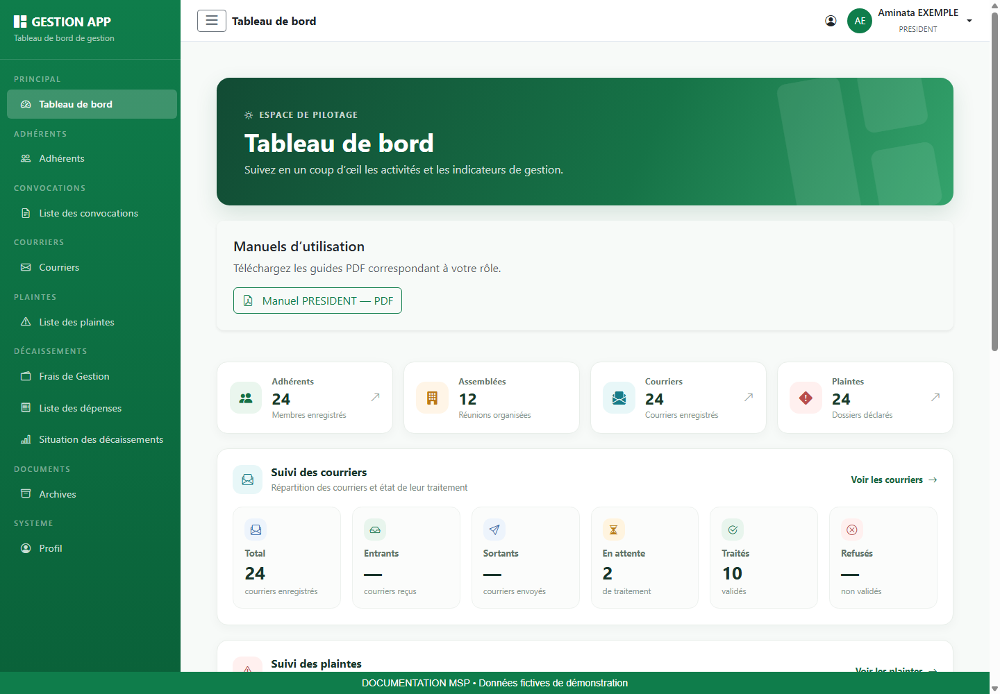

### Lire les illustrations et les commandes

Les images sont de véritables captures de l’interface, réalisées localement avec une API de démonstration et des données fictives. Les écrans de modules sont mutualisés et montrent un compte Administrateur habilité ; les captures du tableau de bord sont propres à chaque rôle. Les listes vides illustrent un écran sans dossier, et non une panne. Les valeurs visibles ne sont pas des données d’exploitation.

| Champ / repère | Comment le renseigner ou le lire |
| --- | --- |
| Vert MSP | Actions principales et repères de navigation ; couleur de référence #0F7D4B. |
| Étoile près d’un champ | Information obligatoire ; compléter également les champs conditionnels affichés. |
| Message rouge | Erreur à lire et corriger avant de recommencer. |
| Bouton désactivé | Action indisponible tant que le formulaire est incomplet, qu’un chargement est en cours ou qu’aucune donnée n’est disponible. |
| Chargement | Attendre le résultat avant de cliquer à nouveau. |

## 2. Se connecter et retrouver son espace

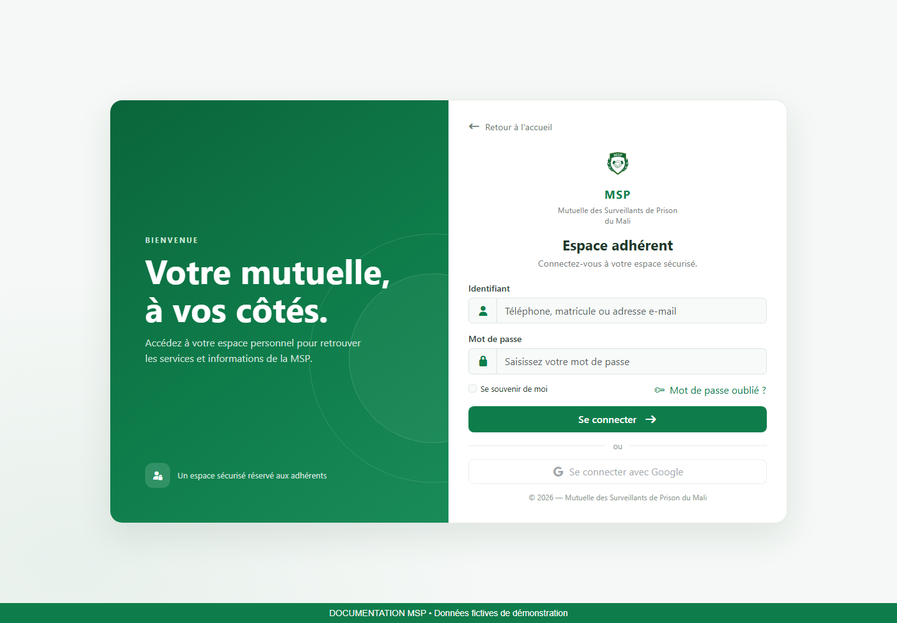

### Connexion pas à pas

1. Ouvrez l’adresse de l’application dans votre navigateur, puis accédez à la page de connexion.
2. Dans Identifiant, saisissez le téléphone, le matricule ou l’adresse e-mail de votre compte, comme indiqué dans le champ. Renseignez ensuite votre mot de passe.
3. Vérifiez la saisie, puis utilisez le bouton de connexion. Attendez la redirection.
4. Sur le tableau de bord, contrôlez le nom et le rôle en haut à droite. Si l’identité ne correspond pas à votre compte, déconnectez-vous.

### Mot de passe oublié ou accès refusé

Utilisez le lien de mot de passe oublié présent sur la page de connexion. Renseignez l’adresse e-mail demandée, puis suivez le lien de réinitialisation reçu. Sur la page de réinitialisation, choisissez et confirmez le nouveau mot de passe. Si le lien n’est plus valable, recommencez la demande ; si vous n’avez pas accès à l’adresse enregistrée, contactez le responsable des comptes.

Si vos identifiants sont refusés, vérifiez la saisie et le verrouillage des majuscules. Si l’échec persiste, faites vérifier l’état du compte. Une erreur de chargement après connexion doit être distinguée d’un mot de passe incorrect.

## 3. Utiliser le tableau de bord et télécharger son manuel

1. Repérez le menu latéral. Le bouton à trois traits permet de réduire ou développer ce menu.
2. Lisez les indicateurs affichés, puis ouvrez un module autorisé si vous devez examiner les dossiers correspondants.
3. Dans Manuels d’utilisation, cliquez sur le bouton du guide associé à votre rôle.
4. Attendez la fin du téléchargement, puis ouvrez le PDF depuis les téléchargements du navigateur.
5. Utilisez le sommaire cliquable ou les signets du lecteur PDF pour retrouver une procédure.

> Si les manuels ne se chargent pas, utilisez Réessayer. Si un téléchargement échoue, vérifiez votre connexion et recommencez après avoir relu le message. Un manuel téléchargé est une copie : téléchargez-le à nouveau après une mise à jour de l’application.

Les statistiques sont des repères de suivi. Le contenu et les raccourcis varient selon les permissions ; un total affiché ne donne pas automatiquement accès à toutes les fiches.

## 4. Rechercher et consulter un adhérent

**Accès :** Menu Adhérents. Cette liste est accessible aux fonctions habilitées ; le simple rôle Adhérent ne fait pas apparaître ce menu dans la version actuelle.

**Objectif :** Retrouver un membre sans créer de doublon et consulter les informations utiles à votre travail.

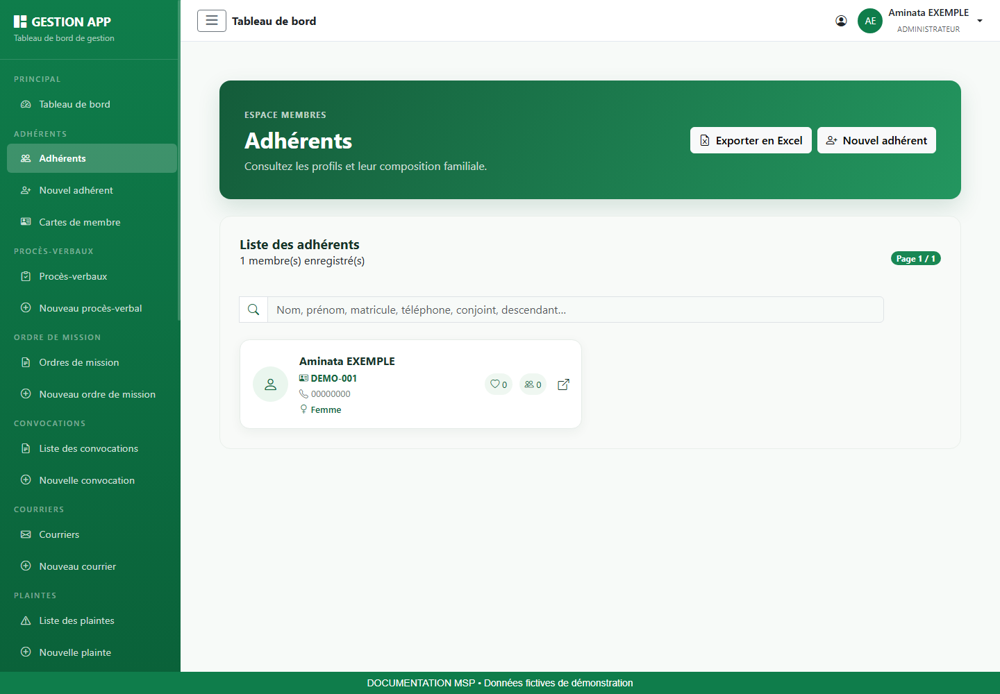

### Champs et informations à vérifier

| Champ / repère | Comment le renseigner ou le lire |
| --- | --- |
| Recherche | Utiliser les critères indiqués dans la zone de recherche, par exemple le nom ou le matricule. |
| Pagination | Changer de page lorsque le résultat ne tient pas sur un seul écran. |
| Actions | Ouvrir la fiche lorsque votre fonction l’autorise ; les commandes de modification et de carte dépendent de vos droits. |

### Procédure pas à pas

1. Ouvrez Adhérents dans le menu latéral.
2. Saisissez un critère précis. Vérifiez l’orthographe et retirez les filtres trop restrictifs si aucun résultat ne s’affiche.
3. Comparez le prénom, le nom et le matricule avant de sélectionner la personne. Deux personnes peuvent porter le même nom.
4. Ouvrez la fiche si l’action est proposée. Consultez les coordonnées, la famille et les pièces jointes nécessaires.
5. Revenez à la liste pour poursuivre votre recherche.

### Résultat attendu et contrôles

Le matricule et l’identité doivent correspondre au dossier demandé. Une liste vide ne signifie pas nécessairement qu’un membre n’existe pas : contrôlez la recherche et la page sélectionnée.

### Export de la liste
Lorsque le bouton d’export est présent, cliquez dessus puis ouvrez le fichier téléchargé dans votre tableur. Vérifiez les colonnes et le nombre de lignes. L’export peut contenir des informations personnelles et familiales ; conservez-le dans l’emplacement de travail prévu. Un message « Aucun adhérent à exporter » indique que l’export ne contient aucune ligne.

## 5. Valider ou rejeter une dépense

**Accès :** Menu Dépenses, pour les comptes disposant du droit de validation des décaissements.

**Objectif :** Prendre une décision traçable après vérification du montant, du rattachement et du justificatif.

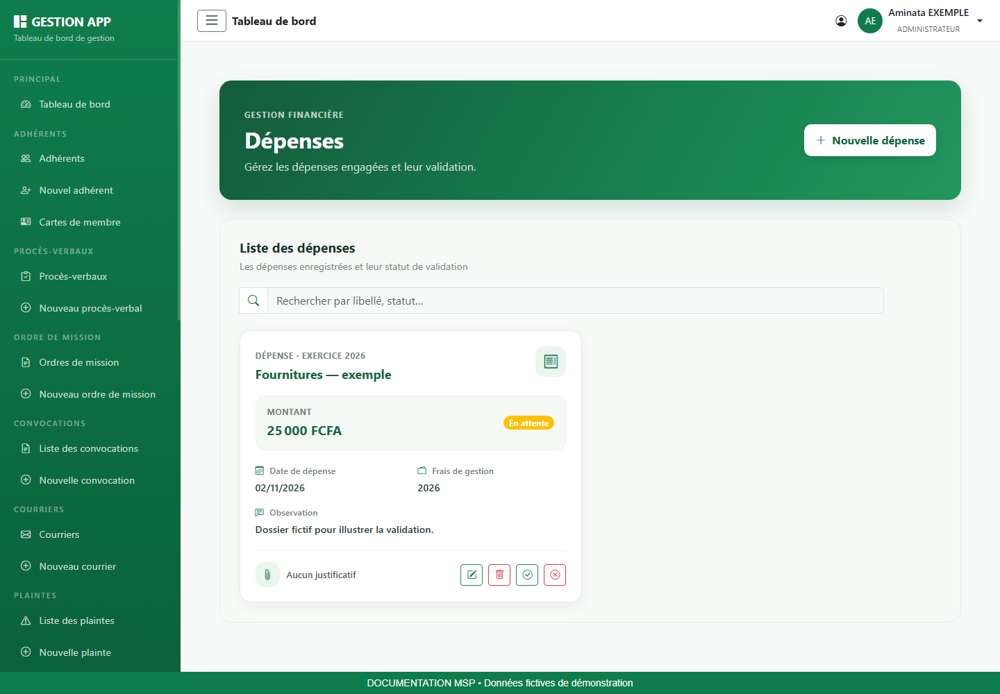

### Champs et informations à vérifier

| Champ / repère | Comment le renseigner ou le lire |
| --- | --- |
| En attente | Dossier pouvant recevoir une décision si votre compte est habilité. |
| Valider | Ouvre une fenêtre de confirmation ; observation facultative. |
| Rejeter | Ouvre une fenêtre exigeant un motif de rejet. |
| Validée / Rejetée | Résultat de la décision visible dans la liste. |

### Procédure pas à pas

1. Recherchez la dépense et vérifiez son libellé, son année, son montant et sa pièce jointe.
2. Si le dossier est En attente, cliquez sur Valider ou Rejeter.
3. Pour un rejet, rédigez un motif explicite permettant au demandeur de comprendre le problème. Pour une validation, ajoutez une observation si nécessaire.
4. Relisez la décision puis cliquez sur Confirmer la validation ou Confirmer le rejet.
5. Attendez le résultat et contrôlez le nouveau statut dans la liste.
6. Si la demande échoue, relisez le message. Rechargez la liste avant de tenter une nouvelle décision afin de vérifier qu’un autre utilisateur n’a pas déjà traité le dossier.

### Résultat attendu et contrôles

Le motif de rejet est obligatoire. Une dépense Validée signifie que la décision a été enregistrée ; ce statut n’atteste pas à lui seul d’un paiement.

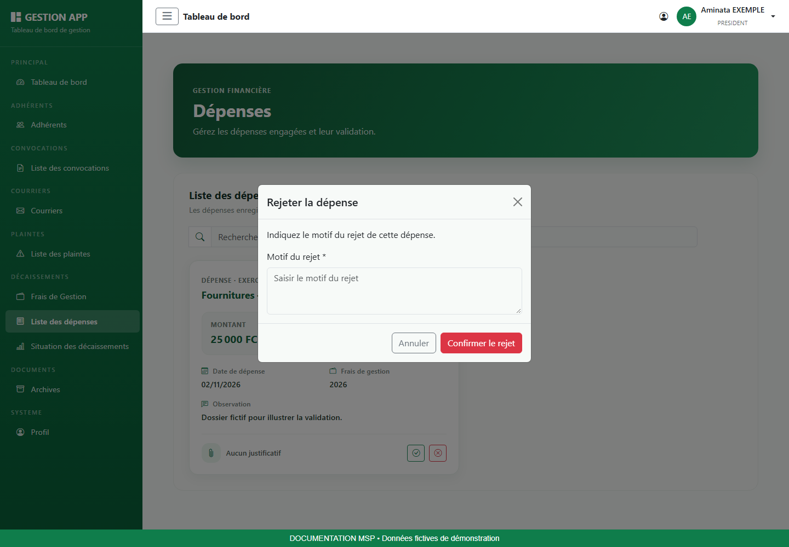

## 6. Lire la situation des décaissements

**Accès :** Menu Situation des décaissements selon vos droits de consultation des dépenses.

**Objectif :** Comparer les montants mensuels en distinguant les statuts des dépenses.

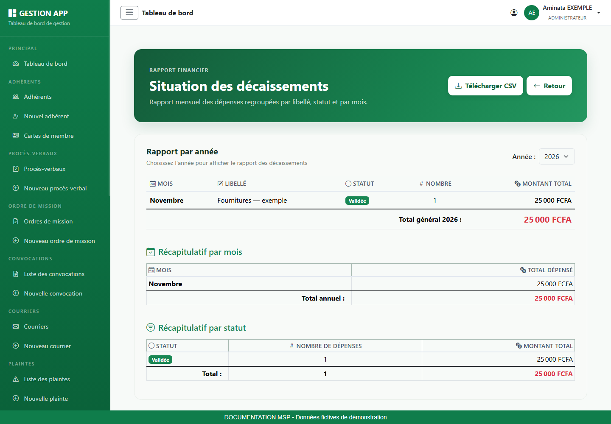

### Champs et informations à vérifier

| Champ / repère | Comment le renseigner ou le lire |
| --- | --- |
| Année | Exercice utilisé pour le rapport. |
| Mois et libellé | Période et description du regroupement. |
| Statut | En attente, Validée ou Rejetée ; lire ce statut avant d’interpréter le montant. |
| Nombre / montant total | Nombre d’enregistrements et somme pour la ligne. |
| Total général | Somme du rapport sélectionné ; elle ne doit pas être interprétée automatiquement comme une somme payée. |

### Procédure pas à pas

1. Ouvrez le rapport et sélectionnez l’année.
2. Repérez les lignes du mois et du libellé recherchés.
3. Lisez séparément les statuts pour éviter de confondre demandes, validations et rejets.
4. Comparez le nombre de dossiers et les montants aux dépenses sources.
5. Téléchargez le CSV si nécessaire et vérifiez le contenu dans votre tableur.

### Résultat attendu et contrôles

Une dépense rejetée peut figurer dans un regroupement portant ce statut. Le rapport présente des enregistrements de dépenses ; vérifiez le périmètre avant toute utilisation comptable.

## 7. Enregistrer et suivre le courrier

**Accès :** Menu Courriers pour la consultation ; Nouveau courrier et les actions de modification nécessitent les droits correspondants.

**Objectif :** Conserver une référence, un objet, un correspondant et le document du courrier entrant ou sortant.

> Pour votre rôle : cette procédure couvre la consultation et le contrôle. Les champs ci-dessous expliquent les informations du dossier ; votre compte ne reçoit pas de droit de création ou de modification par la lecture de ce guide.

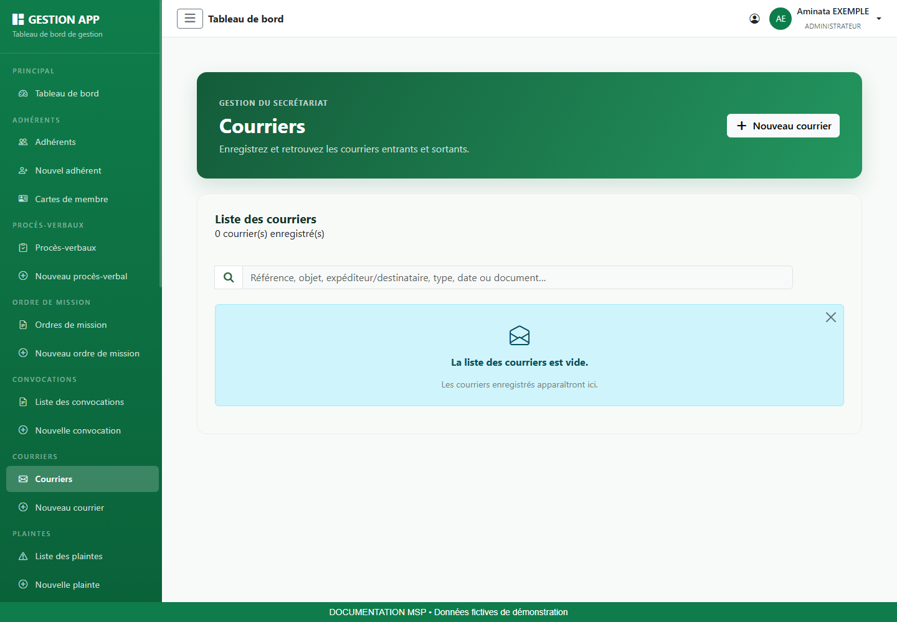

### Champs et informations à vérifier

| Champ / repère | Comment le renseigner ou le lire |
| --- | --- |
| Référence | Identifiant permettant de retrouver le courrier. |
| Type de courrier | Courrier entrant ou courrier sortant. |
| Objet | Résumé précis de la demande ou de la réponse. |
| Expéditeur / destinataire | Auteur du courrier reçu ou destinataire du courrier envoyé. |
| Date | Date de réception pour un entrant, date d’envoi pour un sortant. |
| Document | Obligatoire à la création ; en modification, laisser le fichier inchangé pour conserver la pièce actuelle. |

### Procédure pas à pas

1. Ouvrez le menu de liste indiqué ci-dessus.
2. Recherchez le dossier à partir de sa référence, de son objet ou de sa date, selon les critères proposés.
3. Comparez les informations de la ligne au dossier attendu, puis ouvrez les détails ou la pièce.
4. Vérifiez les informations présentées dans le tableau ci-dessous et la lisibilité du document associé.
5. Refermez l’aperçu pour revenir à la liste. Si une information est incorrecte, transmettez la référence au responsable du module.

### Résultat attendu et contrôles

Le sens entrant/sortant, la date et le correspondant doivent correspondre au document. En cas de remplacement de fichier, contrôlez la nouvelle pièce après enregistrement.

## 8. Enregistrer et consulter une plainte

**Accès :** Menu Liste des plaintes ; Nouvelle plainte et actions de gestion selon les permissions de votre compte.

**Objectif :** Conserver la date, la description et les pièces d’un dossier de plainte pour permettre son suivi.

> Pour votre rôle : cette procédure couvre la consultation et le contrôle. Les champs ci-dessous expliquent les informations du dossier ; votre compte ne reçoit pas de droit de création ou de modification par la lecture de ce guide.

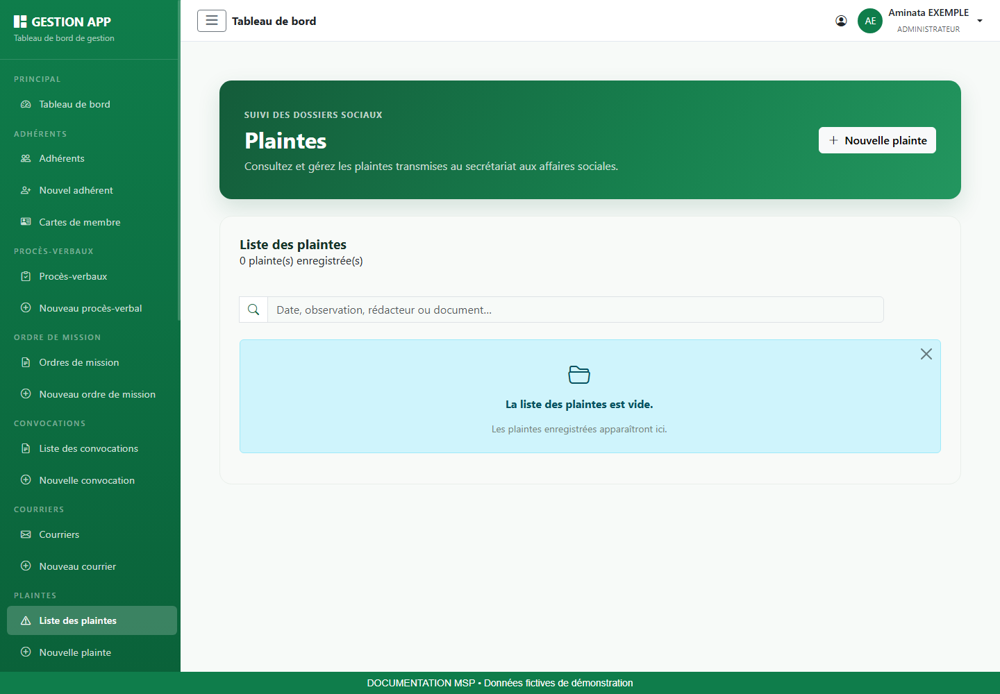

### Champs et informations à vérifier

| Champ / repère | Comment le renseigner ou le lire |
| --- | --- |
| Date de la plainte | Date du dépôt ou de l’enregistrement à retenir pour le dossier. |
| Description de la plainte | Présenter les faits, le contexte et les références utiles de manière factuelle. |
| Document justificatif | Facultatif ; choisir la pièce correspondant au dossier concerné. |

### Procédure pas à pas

1. Ouvrez le menu de liste indiqué ci-dessus.
2. Recherchez le dossier à partir de sa référence, de son objet ou de sa date, selon les critères proposés.
3. Comparez les informations de la ligne au dossier attendu, puis ouvrez les détails ou la pièce.
4. Vérifiez les informations présentées dans le tableau ci-dessous et la lisibilité du document associé.
5. Refermez l’aperçu pour revenir à la liste. Si une information est incorrecte, transmettez la référence au responsable du module.

### Résultat attendu et contrôles

La bonne date et le bon justificatif doivent être associés au dossier. Le suivi visible dans l’application ne dispense pas d’appliquer les procédures internes de traitement.

## 9. Préparer et consulter une convocation

**Accès :** Menu Liste des convocations ; Nouvelle convocation si votre compte possède le droit de création.

**Objectif :** Conserver une convocation datée et sa description, avec une pièce jointe si nécessaire.

> Pour votre rôle : cette procédure couvre la consultation et le contrôle. Les champs ci-dessous expliquent les informations du dossier ; votre compte ne reçoit pas de droit de création ou de modification par la lecture de ce guide.

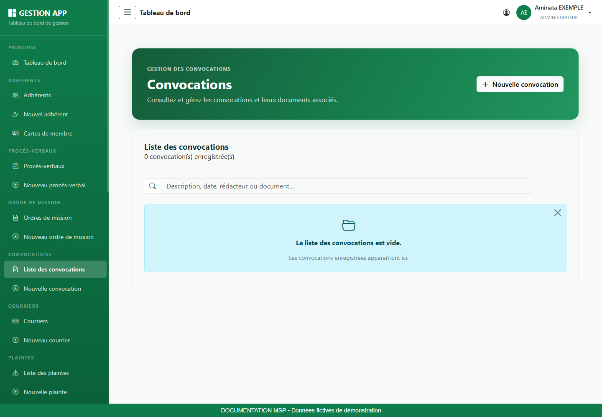

### Champs et informations à vérifier

| Champ / repère | Comment le renseigner ou le lire |
| --- | --- |
| Date de la convocation | Date renseignée sur la convocation. |
| Description | Préciser le contexte, l’objet et les informations utiles aux destinataires. |
| Document justificatif | Facultatif ; PDF ou image selon le champ proposé. |

### Procédure pas à pas

1. Ouvrez le menu de liste indiqué ci-dessus.
2. Recherchez le dossier à partir de sa référence, de son objet ou de sa date, selon les critères proposés.
3. Comparez les informations de la ligne au dossier attendu, puis ouvrez les détails ou la pièce.
4. Vérifiez les informations présentées dans le tableau ci-dessous et la lisibilité du document associé.
5. Refermez l’aperçu pour revenir à la liste. Si une information est incorrecte, transmettez la référence au responsable du module.

### Résultat attendu et contrôles

La convocation enregistrée doit correspondre à la bonne réunion. L’enregistrement dans l’application ne prouve pas son envoi aux destinataires ; appliquez le circuit de diffusion de votre organisation.

## 10. Rechercher et ouvrir les archives

**Accès :** Menu Archives pour les comptes disposant des droits de liste et de consultation.

**Objectif :** Retrouver les documents classés par catégorie et consulter la pièce associée.

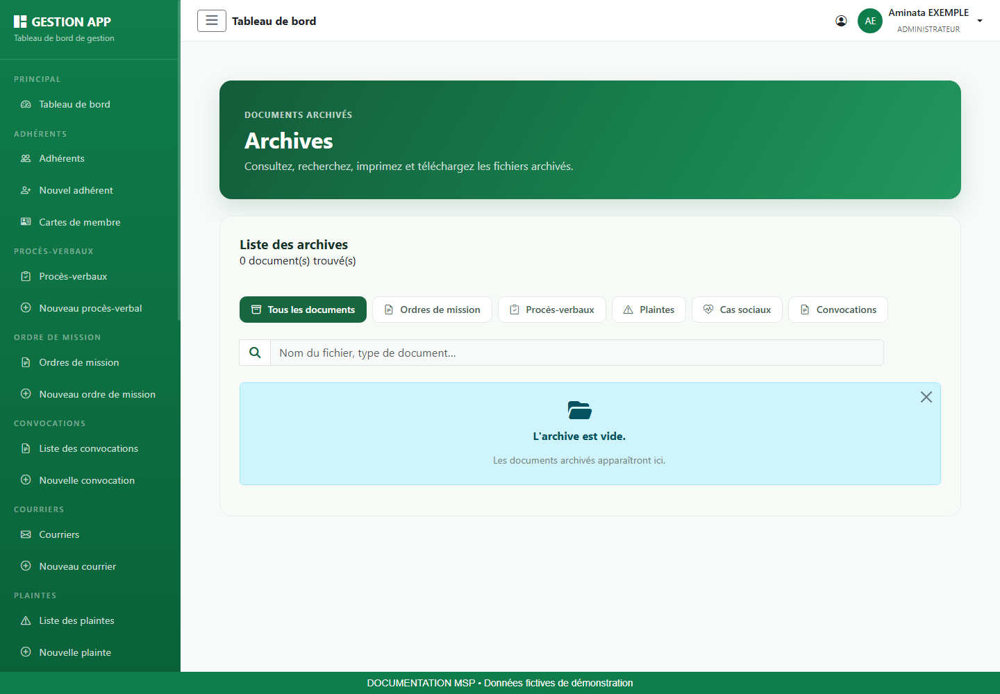

### Champs et informations à vérifier

| Champ / repère | Comment le renseigner ou le lire |
| --- | --- |
| Recherche | Saisir un terme identifiable dans la référence ou le libellé. |
| Catégorie | Choisir la famille de documents si le filtre est proposé. |
| Document | Ouvrir l’aperçu ou l’action de consultation proposée sur la ligne. |

### Procédure pas à pas

1. Ouvrez Archives et identifiez la catégorie du document recherché.
2. Saisissez un critère, puis retirez les filtres trop restrictifs si la liste est vide.
3. Comparez la référence et les informations de la ligne au dossier attendu.
4. Ouvrez l’aperçu. Vérifiez qu’il s’agit de la bonne pièce et qu’elle est lisible.
5. Utilisez les actions proposées par la visionneuse si vous devez conserver une copie. Refermez l’aperçu pour revenir aux résultats.

### Résultat attendu et contrôles

Une archive consultable ne donne pas automatiquement le droit de modifier le dossier d’origine. Si le fichier est absent ou illisible, signalez sa référence au responsable du module.

## 11. Désigner et suivre un adjoint

**Accès :** Menu Désignation des adjoints uniquement lorsqu’il est proposé et que votre compte est habilité à déléguer.

**Objectif :** Définir une délégation sur une période précise et en suivre l’historique.

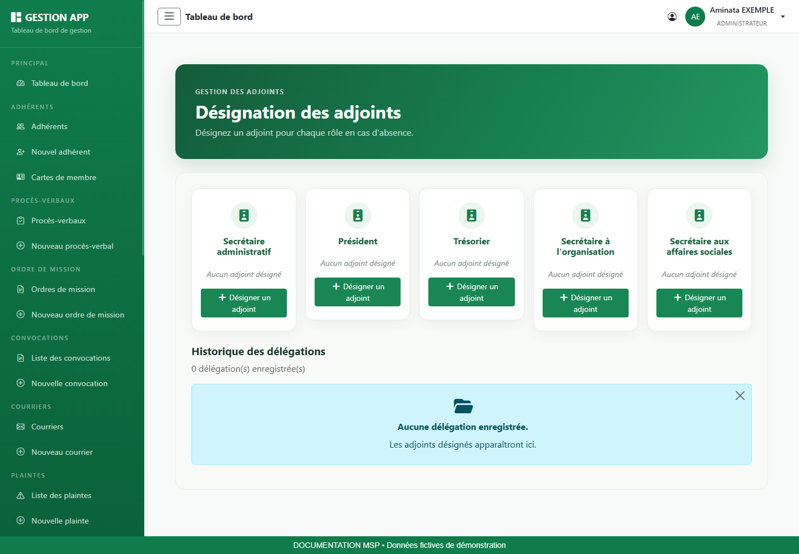

### Champs et informations à vérifier

| Champ / repère | Comment le renseigner ou le lire |
| --- | --- |
| Fonction à déléguer | Choisir la carte de fonction proposée par votre compte. |
| Adhérent adjoint | Rechercher la personne puis la sélectionner dans les résultats. |
| Début / fin | Dates définissant la période de délégation. |
| Motif | Explication utile du remplacement. |
| Historique | Consulter les délégations et les actions de suivi disponibles. |

### Procédure pas à pas

1. Vérifiez la fonction concernée et la période d’absence avant d’ouvrir le formulaire.
2. Dans Désignation des adjoints, cliquez sur la commande de désignation de la fonction autorisée.
3. Recherchez le remplaçant et sélectionnez son identité.
4. Complétez début, fin et motif. Vérifiez que la fin ne précède pas le début.
5. Enregistrez puis contrôlez la présence de la délégation dans l’historique.
6. Si la délégation doit être interrompue ou corrigée, utilisez uniquement l’action proposée sur la ligne et vérifiez son résultat.

### Résultat attendu et contrôles

Le rôle seul ne garantit pas l’apparition du menu : la permission de délégation doit être configurée. La capture présente l’écran d’un compte de démonstration habilité.

## 12. Mettre à jour son profil et son mot de passe

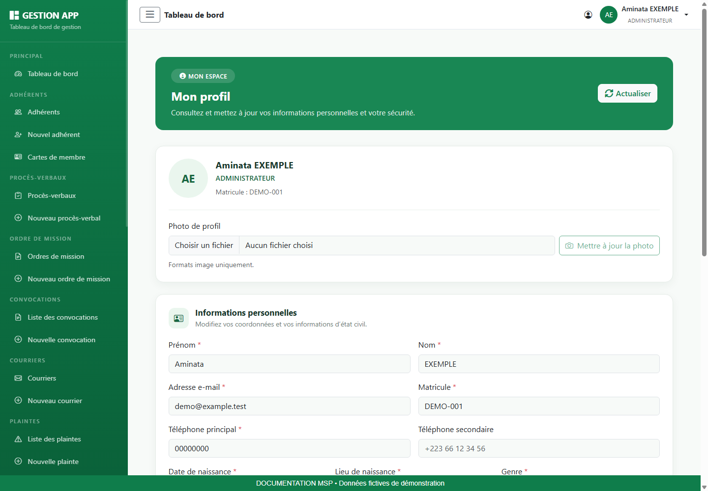

### Consulter et modifier ses informations

1. Ouvrez Profil dans le menu latéral ou utilisez l’accès proposé dans la barre supérieure.
2. Vérifiez l’identité affichée, le rôle et le matricule. Cliquez sur Actualiser si vous devez recharger les informations.
3. Dans Informations personnelles, corrigez les coordonnées ou informations nécessaires. Les champs marqués d’une étoile doivent rester renseignés.
4. Cliquez sur Enregistrer les modifications et attendez la confirmation.
5. Rechargez le profil pour vérifier que les informations enregistrées sont correctes.

### Changer sa photo

Choisissez une image dans la zone Photo de profil, vérifiez l’aperçu, puis cliquez sur Mettre à jour la photo. Cette action possède son propre bouton : sélectionner un fichier ne signifie pas que la photo est déjà enregistrée. Si le fichier est refusé, choisissez un format image accepté et recommencez.

### Changer son mot de passe

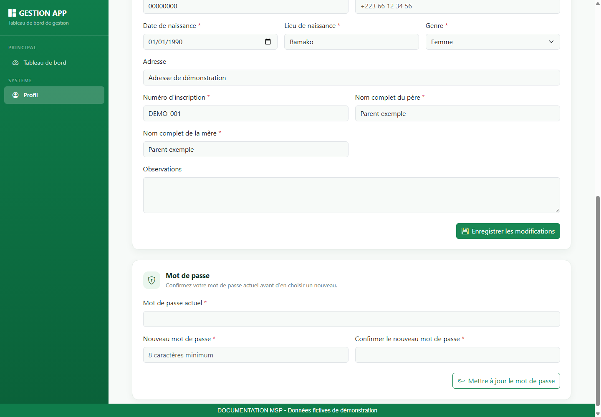

1. Faites défiler le profil jusqu’à Mot de passe.
2. Saisissez le mot de passe actuel.
3. Saisissez le nouveau mot de passe, d’au moins huit caractères, puis la même valeur dans la confirmation.
4. Cliquez sur Mettre à jour le mot de passe et attendez le résultat.
5. Si la saisie est refusée, relisez le message : contrôlez le mot de passe actuel et l’égalité des deux nouvelles valeurs.

> Les informations du profil et le mot de passe s’enregistrent séparément. Le bouton du profil n’enregistre pas automatiquement un changement de mot de passe.

## 13. Terminer sa session et résoudre les difficultés

### Déconnexion

1. Terminez l’enregistrement en cours et vérifiez le message de résultat.
2. Ouvrez le menu de votre compte en haut à droite.
3. Choisissez Déconnexion et vérifiez le retour à l’écran public ou de connexion.
4. Sur un poste partagé, fermez également les documents téléchargés et la fenêtre de navigation.

### Aide au diagnostic

| Champ / repère | Comment le renseigner ou le lire |
| --- | --- |
| Menu absent | Vérifier le rôle affiché et demander le contrôle des permissions. Une illustration du manuel peut montrer un compte plus habilité. |
| Liste vide | Supprimer les filtres, vérifier la période et la pagination. |
| Champs refusés | Relire le message, compléter les champs obligatoires et vérifier les dates, montants et sélections. |
| Bouton Enregistrer grisé | Vérifier les champs obligatoires et attendre la fin du chargement. |
| Fichier non accepté | Vérifier l’extension demandée et la lisibilité. Sélectionner à nouveau la bonne pièce. |
| Erreur réseau ou session expirée | Vérifier la connexion, rouvrir la session puis contrôler si la dernière opération a été enregistrée avant de la répéter. |
| PDF introuvable | Consulter les téléchargements du navigateur ; vérifier le rôle et réessayer le téléchargement sur le tableau de bord. |

### Signaler une difficulté utilement

Transmettez au responsable le module concerné, la référence du dossier, l’action effectuée, l’heure et le message exact. Une capture limitée à la zone en erreur aide à comprendre le problème ; masquez les informations personnelles inutiles. Ne transmettez jamais votre mot de passe.

### Vérification de fin de travail

- Les opérations enregistrées ont été vérifiées dans leur liste ou leur fiche.
- Les pièces sont lisibles et rattachées au bon dossier.
- Les exports ont été conservés dans l’emplacement de travail prévu.
- La session est fermée lorsque le poste est laissé à une autre personne.
