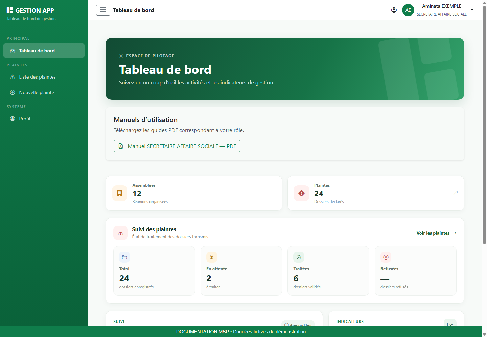
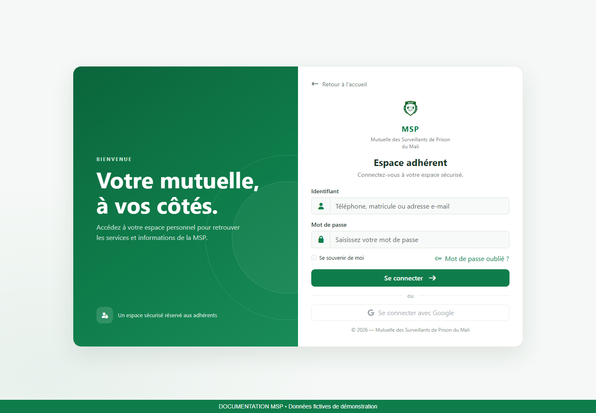
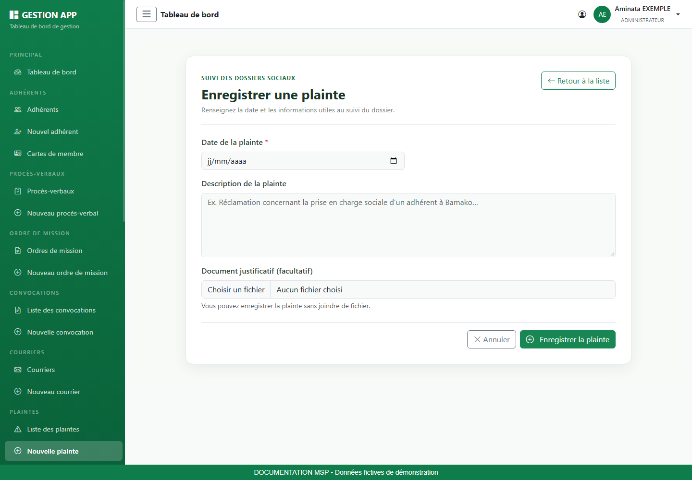
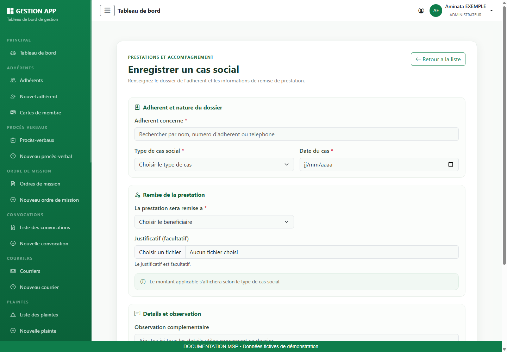
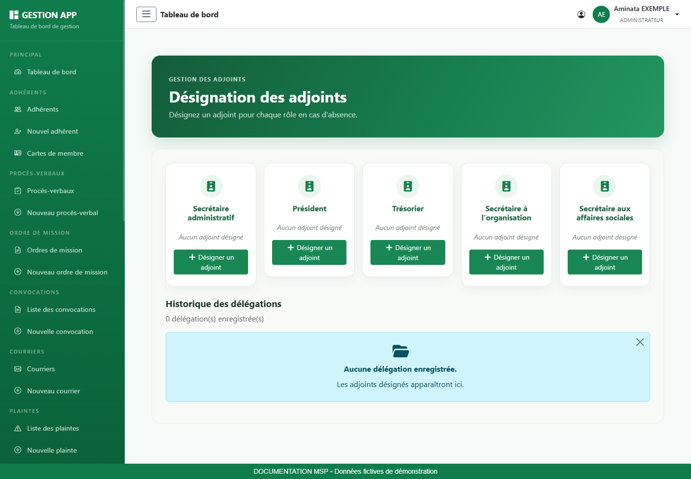
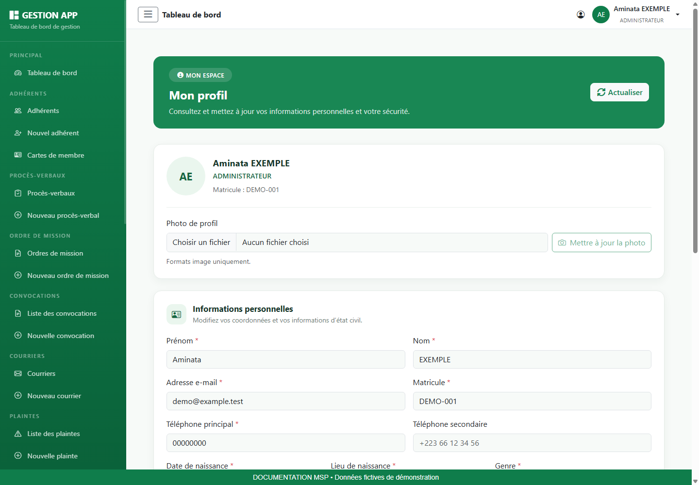
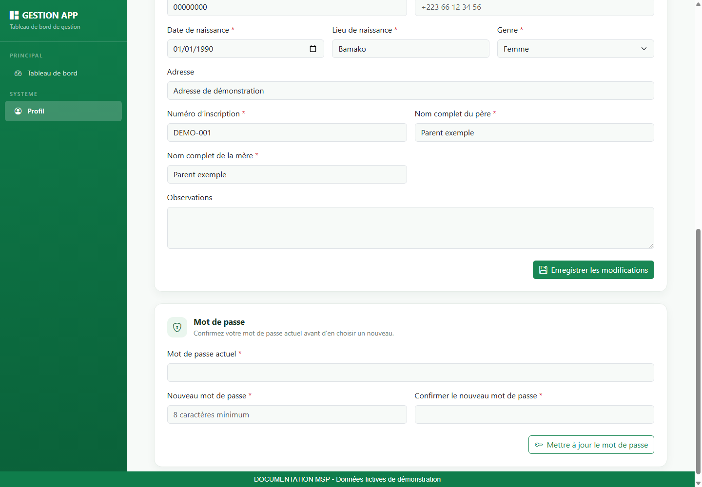

# Manuel utilisateur — Secrétaire aux affaires sociales

Mutuelle des Surveillants de Prison du Mali (MSP). Édition novembre 2026.

## 1. Votre rôle et les repères de ce guide

Enregistrer les plaintes et suivre les dossiers sociaux autorisés, en vérifiant les faits et les justificatifs.

### Ce que vous devez préparer

- L’adresse de l’application communiquée par votre organisation et vos identifiants personnels.
- Pour une saisie : les références, dates, montants et pièces du dossier. Vérifiez leur lisibilité avant de commencer.
- Pour une consultation : un critère de recherche précis, par exemple un matricule, une référence ou une période.

### Comprendre vos accès

Les menus sont calculés à partir du rôle et des autorisations de votre compte. Une fonction décrite dans ce guide peut être absente si votre compte n’est pas habilité. Demandez au responsable des accès de vérifier la configuration ; ne cherchez pas à contourner le menu.

> Attention au périmètre : les fonctions d’organisation et certains dossiers sociaux ne reçoivent pas automatiquement toutes les permissions métier dans la configuration initiale. Les chapitres concernés sont des procédures conditionnelles, applicables uniquement lorsque le menu et les actions sont autorisés.

### Lire les illustrations et les commandes

Les images sont de véritables captures de l’interface, réalisées localement avec une API de démonstration et des données fictives. Les écrans de modules sont mutualisés et montrent un compte Administrateur habilité ; les captures du tableau de bord sont propres à chaque rôle. Les listes vides illustrent un écran sans dossier, et non une panne. Les valeurs visibles ne sont pas des données d’exploitation.

| Champ / repère | Comment le renseigner ou le lire |
| --- | --- |
| Vert MSP | Actions principales et repères de navigation ; couleur de référence #0F7D4B. |
| Étoile près d’un champ | Information obligatoire ; compléter également les champs conditionnels affichés. |
| Message rouge | Erreur à lire et corriger avant de recommencer. |
| Bouton désactivé | Action indisponible tant que le formulaire est incomplet, qu’un chargement est en cours ou qu’aucune donnée n’est disponible. |
| Chargement | Attendre le résultat avant de cliquer à nouveau. |

## 2. Se connecter et retrouver son espace

### Connexion pas à pas

1. Ouvrez l’adresse de l’application dans votre navigateur, puis accédez à la page de connexion.
2. Dans Identifiant, saisissez le téléphone, le matricule ou l’adresse e-mail de votre compte, comme indiqué dans le champ. Renseignez ensuite votre mot de passe.
3. Vérifiez la saisie, puis utilisez le bouton de connexion. Attendez la redirection.
4. Sur le tableau de bord, contrôlez le nom et le rôle en haut à droite. Si l’identité ne correspond pas à votre compte, déconnectez-vous.

### Mot de passe oublié ou accès refusé

Utilisez le lien de mot de passe oublié présent sur la page de connexion. Renseignez l’adresse e-mail demandée, puis suivez le lien de réinitialisation reçu. Sur la page de réinitialisation, choisissez et confirmez le nouveau mot de passe. Si le lien n’est plus valable, recommencez la demande ; si vous n’avez pas accès à l’adresse enregistrée, contactez le responsable des comptes.

Si vos identifiants sont refusés, vérifiez la saisie et le verrouillage des majuscules. Si l’échec persiste, faites vérifier l’état du compte. Une erreur de chargement après connexion doit être distinguée d’un mot de passe incorrect.

## 3. Utiliser le tableau de bord et télécharger son manuel

1. Repérez le menu latéral. Le bouton à trois traits permet de réduire ou développer ce menu.
2. Lisez les indicateurs affichés, puis ouvrez un module autorisé si vous devez examiner les dossiers correspondants.
3. Dans Manuels d’utilisation, cliquez sur le bouton du guide associé à votre rôle.
4. Attendez la fin du téléchargement, puis ouvrez le PDF depuis les téléchargements du navigateur.
5. Utilisez le sommaire cliquable ou les signets du lecteur PDF pour retrouver une procédure.

> Si les manuels ne se chargent pas, utilisez Réessayer. Si un téléchargement échoue, vérifiez votre connexion et recommencez après avoir relu le message. Un manuel téléchargé est une copie : téléchargez-le à nouveau après une mise à jour de l’application.

Les statistiques sont des repères de suivi. Le contenu et les raccourcis varient selon les permissions ; un total affiché ne donne pas automatiquement accès à toutes les fiches.

## 4. Enregistrer et consulter une plainte

**Accès :** Menu Liste des plaintes ; Nouvelle plainte et actions de gestion selon les permissions de votre compte.

**Objectif :** Conserver la date, la description et les pièces d’un dossier de plainte pour permettre son suivi.

### Champs et informations à vérifier

| Champ / repère | Comment le renseigner ou le lire |
| --- | --- |
| Date de la plainte | Date du dépôt ou de l’enregistrement à retenir pour le dossier. |
| Description de la plainte | Présenter les faits, le contexte et les références utiles de manière factuelle. |
| Document justificatif | Facultatif ; choisir la pièce correspondant au dossier concerné. |

### Procédure pas à pas

1. Ouvrez la liste et recherchez un éventuel dossier déjà enregistré.
2. Cliquez sur Nouvelle plainte si vous possédez le droit de création.
3. Renseignez la date et décrivez les faits utiles à la compréhension.
4. Joignez une pièce lisible si elle est disponible. Évitez les éléments sans rapport avec la plainte.
5. Enregistrez puis ouvrez les détails du dossier dans la liste.
6. Pour une correction, utilisez l’action de modification lorsqu’elle est proposée. En cas de suppression, contrôlez soigneusement le dossier avant de confirmer.

### Résultat attendu et contrôles

La bonne date et le bon justificatif doivent être associés au dossier. Le suivi visible dans l’application ne dispense pas d’appliquer les procédures internes de traitement.

## 5. Constituer un dossier de cas social

**Accès :** Menus Cas sociaux et Nouveau cas social uniquement si les permissions LISTER_CAS_SOCIAUX et AJOUTER_CAS_SOCIAUX ont été accordées.

**Objectif :** Saisir un événement social, identifier le bénéficiaire et conserver les éléments nécessaires à l’évaluation du dossier.

### Champs et informations à vérifier

| Champ / repère | Comment le renseigner ou le lire |
| --- | --- |
| Adhérent concerné | Rechercher le membre et sélectionner le résultat proposé. Un nom saisi sans sélection ne suffit pas. |
| Type de cas | Maladie, accident de la circulation, ou radiation / révocation / retraite disciplinaire. |
| Date du cas | Date de l’événement. |
| Hospitalisation | Pour une maladie, renseigner la durée en heures demandée par le formulaire. Le libellé rappelle le seuil de 72 heures. |
| Cotisations versées | Pour le cas disciplinaire, renseigner le total demandé en FCFA à partir des justificatifs. |
| Bénéficiaire | Adhérent ou personne désignée ; compléter l’identité et le téléphone de la personne désignée. |
| Justificatif et observation | Joindre la pièce disponible et expliquer les éléments utiles au dossier. |

### Procédure pas à pas

1. Préparez l’identité du membre, les dates et les éléments justificatifs.
2. Ouvrez Nouveau cas social et sélectionnez l’adhérent dans les résultats de recherche.
3. Choisissez le type. Les champs supplémentaires varient avec ce choix ; renseignez uniquement ceux affichés.
4. Sélectionnez le bénéficiaire et complétez ses coordonnées si une autre personne doit recevoir la prestation.
5. Ajoutez le justificatif, relisez les informations et enregistrez.
6. Consultez les détails pour lire le statut et le montant calculés par l’application.

### Résultat attendu et contrôles

Ne déduisez pas un droit au versement à partir du seul type choisi. Vérifiez le résultat renvoyé, les règles de l’organisation et les pièces. Si le menu est absent, faites vérifier vos permissions.

## 6. Désigner et suivre un adjoint

**Accès :** Menu Désignation des adjoints uniquement lorsqu’il est proposé et que votre compte est habilité à déléguer.

**Objectif :** Définir une délégation sur une période précise et en suivre l’historique.

### Champs et informations à vérifier

| Champ / repère | Comment le renseigner ou le lire |
| --- | --- |
| Fonction à déléguer | Choisir la carte de fonction proposée par votre compte. |
| Adhérent adjoint | Rechercher la personne puis la sélectionner dans les résultats. |
| Début / fin | Dates définissant la période de délégation. |
| Motif | Explication utile du remplacement. |
| Historique | Consulter les délégations et les actions de suivi disponibles. |

### Procédure pas à pas

1. Vérifiez la fonction concernée et la période d’absence avant d’ouvrir le formulaire.
2. Dans Désignation des adjoints, cliquez sur la commande de désignation de la fonction autorisée.
3. Recherchez le remplaçant et sélectionnez son identité.
4. Complétez début, fin et motif. Vérifiez que la fin ne précède pas le début.
5. Enregistrez puis contrôlez la présence de la délégation dans l’historique.
6. Si la délégation doit être interrompue ou corrigée, utilisez uniquement l’action proposée sur la ligne et vérifiez son résultat.

### Résultat attendu et contrôles

Le rôle seul ne garantit pas l’apparition du menu : la permission de délégation doit être configurée. La capture présente l’écran d’un compte de démonstration habilité.

## 7. Mettre à jour son profil et son mot de passe

### Consulter et modifier ses informations

1. Ouvrez Profil dans le menu latéral ou utilisez l’accès proposé dans la barre supérieure.
2. Vérifiez l’identité affichée, le rôle et le matricule. Cliquez sur Actualiser si vous devez recharger les informations.
3. Dans Informations personnelles, corrigez les coordonnées ou informations nécessaires. Les champs marqués d’une étoile doivent rester renseignés.
4. Cliquez sur Enregistrer les modifications et attendez la confirmation.
5. Rechargez le profil pour vérifier que les informations enregistrées sont correctes.

### Changer sa photo

Choisissez une image dans la zone Photo de profil, vérifiez l’aperçu, puis cliquez sur Mettre à jour la photo. Cette action possède son propre bouton : sélectionner un fichier ne signifie pas que la photo est déjà enregistrée. Si le fichier est refusé, choisissez un format image accepté et recommencez.

### Changer son mot de passe

1. Faites défiler le profil jusqu’à Mot de passe.
2. Saisissez le mot de passe actuel.
3. Saisissez le nouveau mot de passe, d’au moins huit caractères, puis la même valeur dans la confirmation.
4. Cliquez sur Mettre à jour le mot de passe et attendez le résultat.
5. Si la saisie est refusée, relisez le message : contrôlez le mot de passe actuel et l’égalité des deux nouvelles valeurs.

> Les informations du profil et le mot de passe s’enregistrent séparément. Le bouton du profil n’enregistre pas automatiquement un changement de mot de passe.

## 8. Terminer sa session et résoudre les difficultés

### Déconnexion

1. Terminez l’enregistrement en cours et vérifiez le message de résultat.
2. Ouvrez le menu de votre compte en haut à droite.
3. Choisissez Déconnexion et vérifiez le retour à l’écran public ou de connexion.
4. Sur un poste partagé, fermez également les documents téléchargés et la fenêtre de navigation.

### Aide au diagnostic

| Champ / repère | Comment le renseigner ou le lire |
| --- | --- |
| Menu absent | Vérifier le rôle affiché et demander le contrôle des permissions. Une illustration du manuel peut montrer un compte plus habilité. |
| Liste vide | Supprimer les filtres, vérifier la période et la pagination. |
| Champs refusés | Relire le message, compléter les champs obligatoires et vérifier les dates, montants et sélections. |
| Bouton Enregistrer grisé | Vérifier les champs obligatoires et attendre la fin du chargement. |
| Fichier non accepté | Vérifier l’extension demandée et la lisibilité. Sélectionner à nouveau la bonne pièce. |
| Erreur réseau ou session expirée | Vérifier la connexion, rouvrir la session puis contrôler si la dernière opération a été enregistrée avant de la répéter. |
| PDF introuvable | Consulter les téléchargements du navigateur ; vérifier le rôle et réessayer le téléchargement sur le tableau de bord. |

### Signaler une difficulté utilement

Transmettez au responsable le module concerné, la référence du dossier, l’action effectuée, l’heure et le message exact. Une capture limitée à la zone en erreur aide à comprendre le problème ; masquez les informations personnelles inutiles. Ne transmettez jamais votre mot de passe.

### Vérification de fin de travail

- Les opérations enregistrées ont été vérifiées dans leur liste ou leur fiche.
- Les pièces sont lisibles et rattachées au bon dossier.
- Les exports ont été conservés dans l’emplacement de travail prévu.
- La session est fermée lorsque le poste est laissé à une autre personne.
