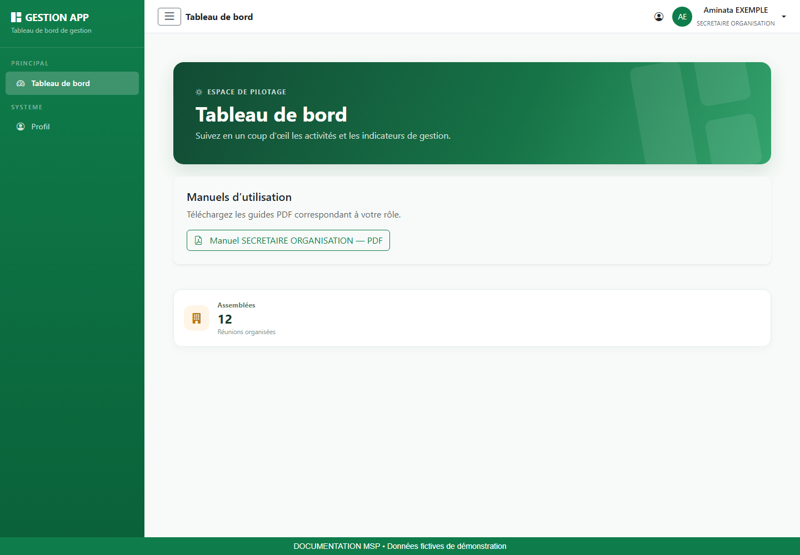
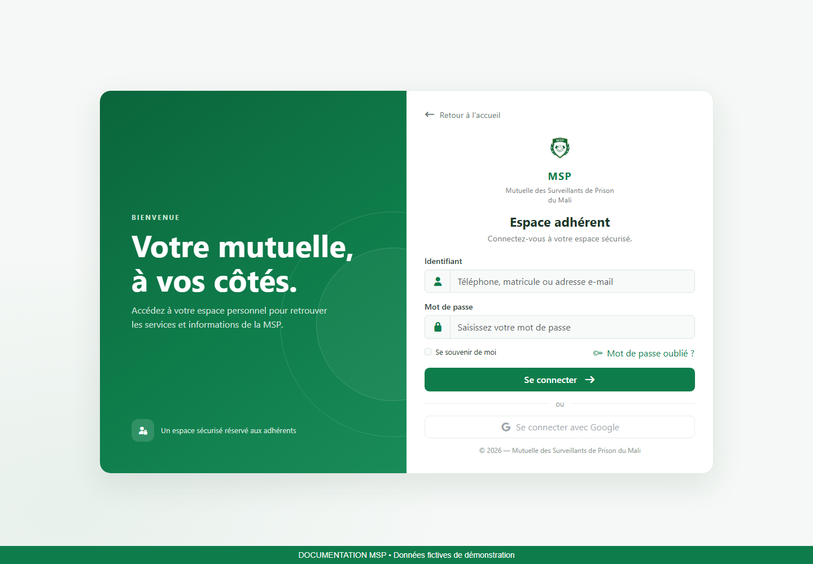
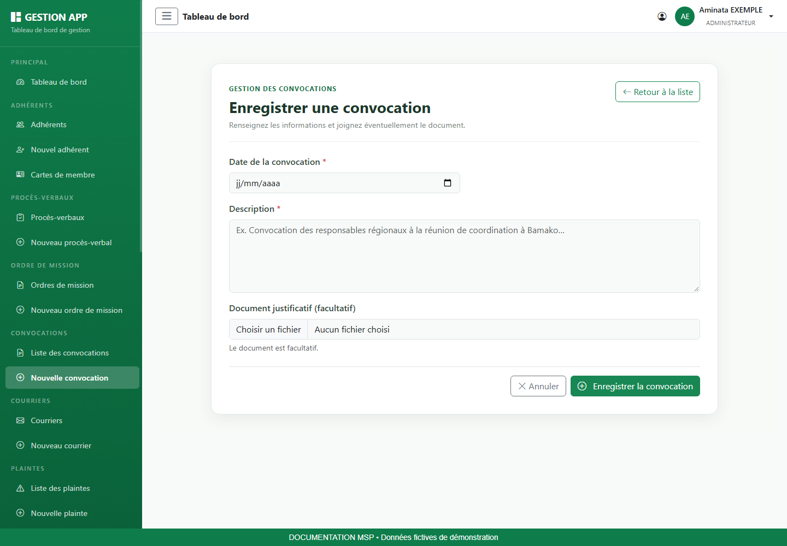
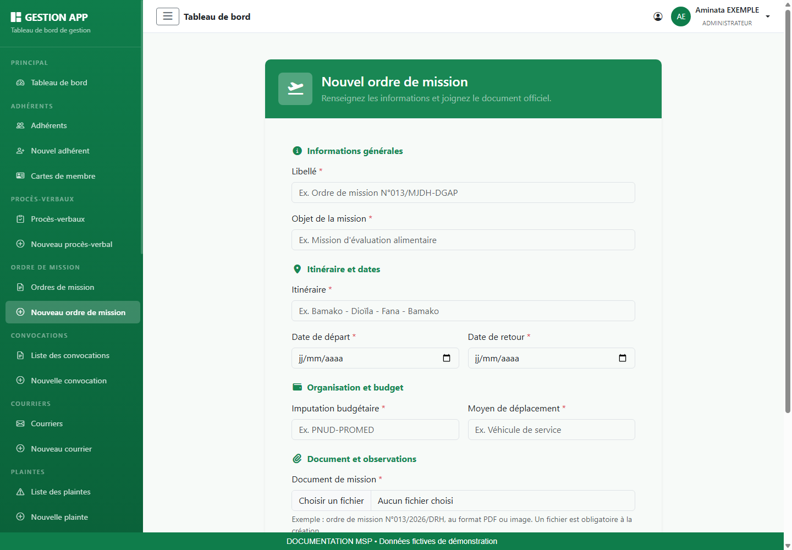
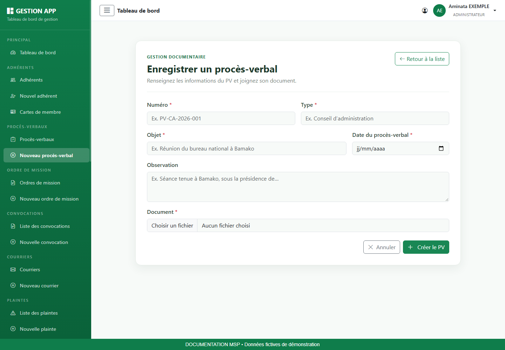
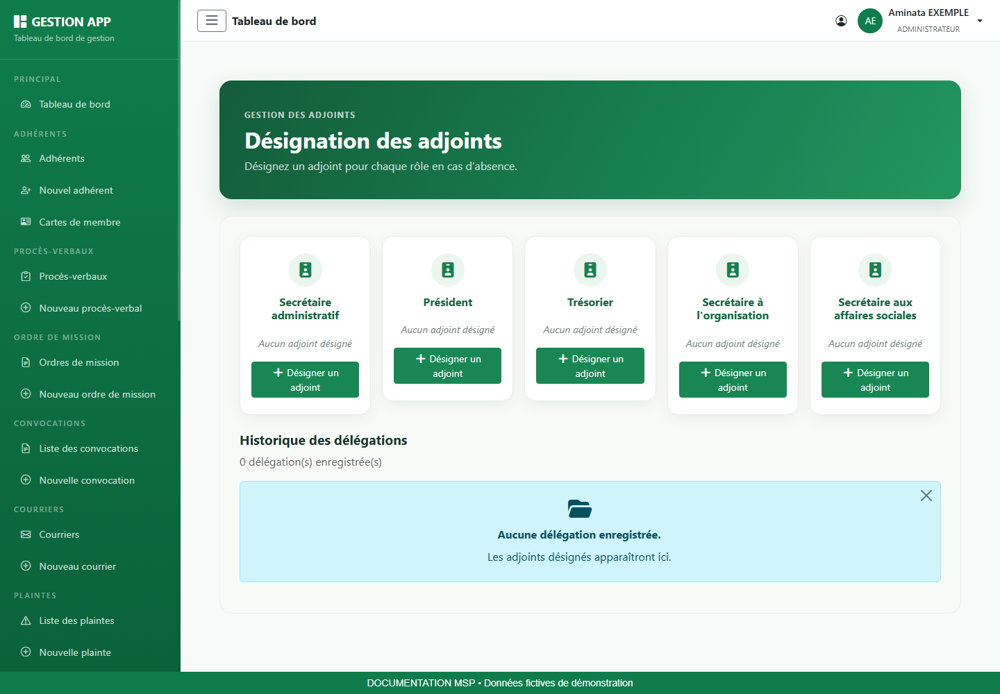
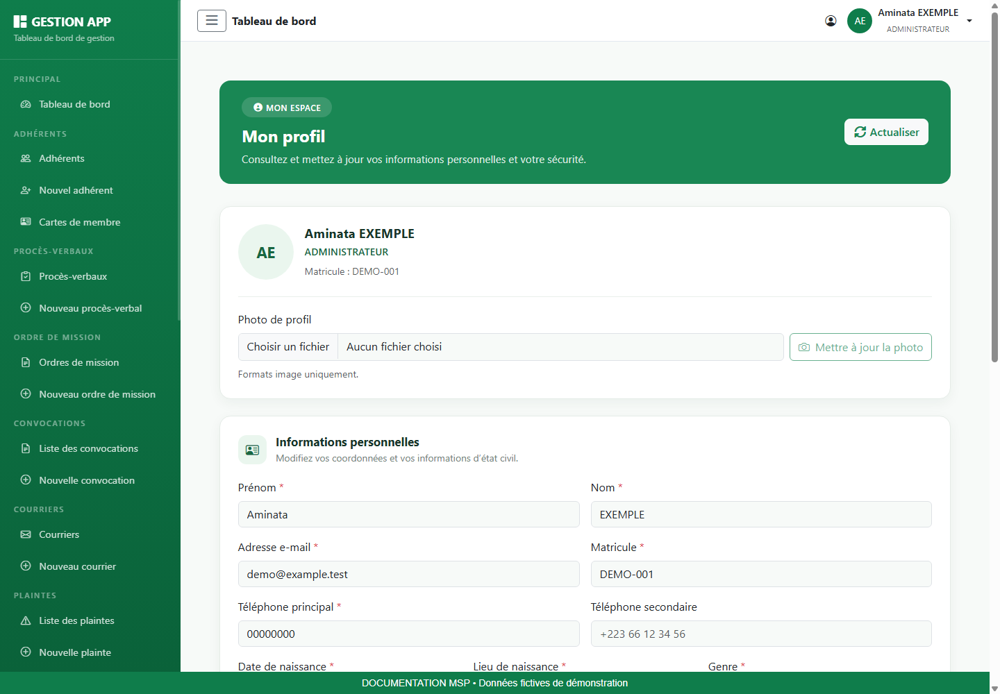
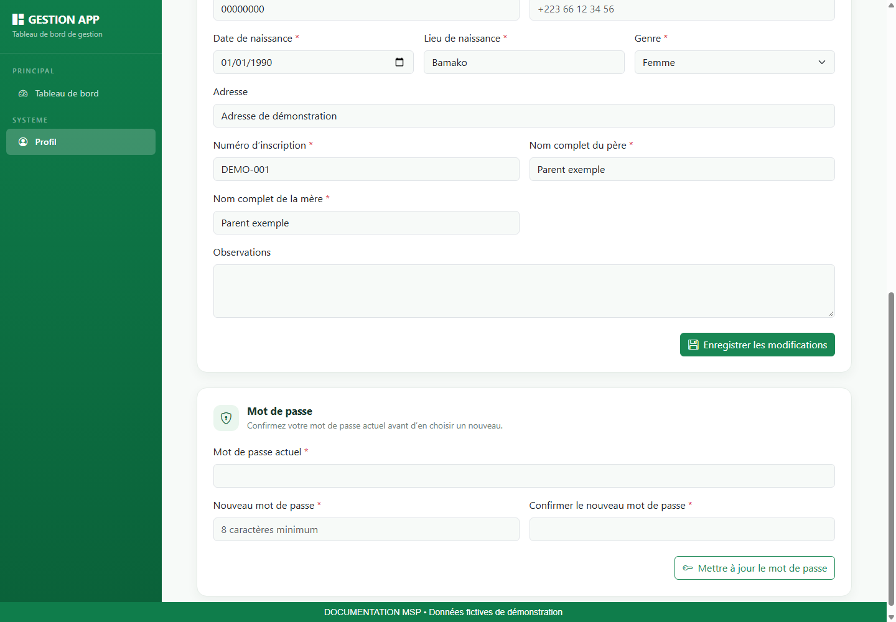

# Manuel utilisateur — Secrétaire à l’organisation

Mutuelle des Surveillants de Prison du Mali (MSP). Édition novembre 2026.

## 1. Votre rôle et les repères de ce guide

Préparer l’organisation des réunions et déplacements lorsque les droits correspondants ont été configurés.

### Ce que vous devez préparer

- L’adresse de l’application communiquée par votre organisation et vos identifiants personnels.
- Pour une saisie : les références, dates, montants et pièces du dossier. Vérifiez leur lisibilité avant de commencer.
- Pour une consultation : un critère de recherche précis, par exemple un matricule, une référence ou une période.

### Comprendre vos accès

Les menus sont calculés à partir du rôle et des autorisations de votre compte. Une fonction décrite dans ce guide peut être absente si votre compte n’est pas habilité. Demandez au responsable des accès de vérifier la configuration ; ne cherchez pas à contourner le menu.

> Attention au périmètre : les fonctions d’organisation et certains dossiers sociaux ne reçoivent pas automatiquement toutes les permissions métier dans la configuration initiale. Les chapitres concernés sont des procédures conditionnelles, applicables uniquement lorsque le menu et les actions sont autorisés.

### Lire les illustrations et les commandes

Les images sont de véritables captures de l’interface, réalisées localement avec une API de démonstration et des données fictives. Les écrans de modules sont mutualisés et montrent un compte Administrateur habilité ; les captures du tableau de bord sont propres à chaque rôle. Les listes vides illustrent un écran sans dossier, et non une panne. Les valeurs visibles ne sont pas des données d’exploitation.

| Champ / repère | Comment le renseigner ou le lire |
| --- | --- |
| Vert MSP | Actions principales et repères de navigation ; couleur de référence #0F7D4B. |
| Étoile près d’un champ | Information obligatoire ; compléter également les champs conditionnels affichés. |
| Message rouge | Erreur à lire et corriger avant de recommencer. |
| Bouton désactivé | Action indisponible tant que le formulaire est incomplet, qu’un chargement est en cours ou qu’aucune donnée n’est disponible. |
| Chargement | Attendre le résultat avant de cliquer à nouveau. |

## 2. Se connecter et retrouver son espace

### Connexion pas à pas

1. Ouvrez l’adresse de l’application dans votre navigateur, puis accédez à la page de connexion.
2. Dans Identifiant, saisissez le téléphone, le matricule ou l’adresse e-mail de votre compte, comme indiqué dans le champ. Renseignez ensuite votre mot de passe.
3. Vérifiez la saisie, puis utilisez le bouton de connexion. Attendez la redirection.
4. Sur le tableau de bord, contrôlez le nom et le rôle en haut à droite. Si l’identité ne correspond pas à votre compte, déconnectez-vous.

### Mot de passe oublié ou accès refusé

Utilisez le lien de mot de passe oublié présent sur la page de connexion. Renseignez l’adresse e-mail demandée, puis suivez le lien de réinitialisation reçu. Sur la page de réinitialisation, choisissez et confirmez le nouveau mot de passe. Si le lien n’est plus valable, recommencez la demande ; si vous n’avez pas accès à l’adresse enregistrée, contactez le responsable des comptes.

Si vos identifiants sont refusés, vérifiez la saisie et le verrouillage des majuscules. Si l’échec persiste, faites vérifier l’état du compte. Une erreur de chargement après connexion doit être distinguée d’un mot de passe incorrect.

## 3. Utiliser le tableau de bord et télécharger son manuel

1. Repérez le menu latéral. Le bouton à trois traits permet de réduire ou développer ce menu.
2. Lisez les indicateurs affichés, puis ouvrez un module autorisé si vous devez examiner les dossiers correspondants.
3. Dans Manuels d’utilisation, cliquez sur le bouton du guide associé à votre rôle.
4. Attendez la fin du téléchargement, puis ouvrez le PDF depuis les téléchargements du navigateur.
5. Utilisez le sommaire cliquable ou les signets du lecteur PDF pour retrouver une procédure.

> Si les manuels ne se chargent pas, utilisez Réessayer. Si un téléchargement échoue, vérifiez votre connexion et recommencez après avoir relu le message. Un manuel téléchargé est une copie : téléchargez-le à nouveau après une mise à jour de l’application.

Les statistiques sont des repères de suivi. Le contenu et les raccourcis varient selon les permissions ; un total affiché ne donne pas automatiquement accès à toutes les fiches.

## 4. Préparer et consulter une convocation

**Accès :** Menu Liste des convocations ; Nouvelle convocation si votre compte possède le droit de création.

**Objectif :** Conserver une convocation datée et sa description, avec une pièce jointe si nécessaire.

### Champs et informations à vérifier

| Champ / repère | Comment le renseigner ou le lire |
| --- | --- |
| Date de la convocation | Date renseignée sur la convocation. |
| Description | Préciser le contexte, l’objet et les informations utiles aux destinataires. |
| Document justificatif | Facultatif ; PDF ou image selon le champ proposé. |

### Procédure pas à pas

1. Consultez la liste afin de repérer une convocation déjà enregistrée.
2. Ouvrez Nouvelle convocation si vous devez en créer une.
3. Renseignez la date puis une description explicite. Vérifiez que le lieu, l’horaire et les destinataires figurent dans la description ou dans la pièce lorsque ces indications sont nécessaires.
4. Joignez le document disponible, puis enregistrez.
5. Retrouvez la convocation dans la liste et ouvrez la pièce pour vérifier son contenu.

### Résultat attendu et contrôles

La convocation enregistrée doit correspondre à la bonne réunion. L’enregistrement dans l’application ne prouve pas son envoi aux destinataires ; appliquez le circuit de diffusion de votre organisation.

## 5. Enregistrer un ordre de mission

**Accès :** Menu Ordres de mission ; Nouveau ordre de mission pour les comptes autorisés à créer.

**Objectif :** Centraliser les informations de déplacement et le document officiel associé.

### Champs et informations à vérifier

| Champ / repère | Comment le renseigner ou le lire |
| --- | --- |
| Libellé et objet | Nom court de la mission et objectif détaillé. |
| Itinéraire | Trajet prévu, avec les étapes nécessaires. |
| Dates de départ et de retour | Vérifier leur cohérence et la période figurant sur l’ordre. |
| Imputation budgétaire | Référence à utiliser pour cette mission. |
| Moyen de déplacement | Moyen effectivement prévu. |
| Ordre de mission | Document PDF ou image obligatoire lors de la création. |
| Observations | Précisions complémentaires. |

### Procédure pas à pas

1. Préparez l’ordre signé ou la pièce officielle à classer.
2. Ouvrez le formulaire depuis le menu de mission.
3. Remplissez libellé, objet et itinéraire avec des indications permettant de distinguer cette mission des autres.
4. Renseignez les dates, l’imputation et le moyen de déplacement.
5. Sélectionnez le document ; relisez tous les champs avant d’enregistrer.
6. Retrouvez la mission dans la liste et consultez ses détails pour contrôler le document.

### Résultat attendu et contrôles

Le retour ne doit pas précéder le départ. Un formulaire enregistré ne remplace pas la validation administrative du document officiel.

## 6. Classer un procès-verbal

**Accès :** Menu Procès-verbaux ; Nouveau procès-verbal pour la création, selon les autorisations.

**Objectif :** Retrouver le compte rendu officiel d’une réunion à partir de son numéro, de son type, de son objet et de sa date.

### Champs et informations à vérifier

| Champ / repère | Comment le renseigner ou le lire |
| --- | --- |
| Numéro et type | Reprendre les références du procès-verbal. |
| Objet | Indiquer le sujet de la réunion ou de la décision. |
| Date du procès-verbal | Utiliser la date figurant sur le document. |
| Observation | Ajouter les précisions utiles sans remplacer le contenu du document. |
| Document | Obligatoire à la création. Le champ accepte un PDF ou une image selon le formulaire. |

### Procédure pas à pas

1. Consultez la liste pour éviter de saisir deux fois le même numéro.
2. Ouvrez Nouveau procès-verbal si vous êtes chargé de l’enregistrement.
3. Renseignez numéro, type, objet et date.
4. Joignez le document complet, y compris les pages de signature si elles font partie du procès-verbal.
5. Enregistrez puis recherchez la référence dans la liste.
6. Ouvrez le document pour vérifier la lisibilité et le nombre de pages.

### Résultat attendu et contrôles

La référence doit mener au bon document. Les lecteurs habilités peuvent consulter les pièces sans disposer des boutons de création ou de suppression.

## 7. Désigner et suivre un adjoint

**Accès :** Menu Désignation des adjoints uniquement lorsqu’il est proposé et que votre compte est habilité à déléguer.

**Objectif :** Définir une délégation sur une période précise et en suivre l’historique.

### Champs et informations à vérifier

| Champ / repère | Comment le renseigner ou le lire |
| --- | --- |
| Fonction à déléguer | Choisir la carte de fonction proposée par votre compte. |
| Adhérent adjoint | Rechercher la personne puis la sélectionner dans les résultats. |
| Début / fin | Dates définissant la période de délégation. |
| Motif | Explication utile du remplacement. |
| Historique | Consulter les délégations et les actions de suivi disponibles. |

### Procédure pas à pas

1. Vérifiez la fonction concernée et la période d’absence avant d’ouvrir le formulaire.
2. Dans Désignation des adjoints, cliquez sur la commande de désignation de la fonction autorisée.
3. Recherchez le remplaçant et sélectionnez son identité.
4. Complétez début, fin et motif. Vérifiez que la fin ne précède pas le début.
5. Enregistrez puis contrôlez la présence de la délégation dans l’historique.
6. Si la délégation doit être interrompue ou corrigée, utilisez uniquement l’action proposée sur la ligne et vérifiez son résultat.

### Résultat attendu et contrôles

Le rôle seul ne garantit pas l’apparition du menu : la permission de délégation doit être configurée. La capture présente l’écran d’un compte de démonstration habilité.

## 8. Mettre à jour son profil et son mot de passe

### Consulter et modifier ses informations

1. Ouvrez Profil dans le menu latéral ou utilisez l’accès proposé dans la barre supérieure.
2. Vérifiez l’identité affichée, le rôle et le matricule. Cliquez sur Actualiser si vous devez recharger les informations.
3. Dans Informations personnelles, corrigez les coordonnées ou informations nécessaires. Les champs marqués d’une étoile doivent rester renseignés.
4. Cliquez sur Enregistrer les modifications et attendez la confirmation.
5. Rechargez le profil pour vérifier que les informations enregistrées sont correctes.

### Changer sa photo

Choisissez une image dans la zone Photo de profil, vérifiez l’aperçu, puis cliquez sur Mettre à jour la photo. Cette action possède son propre bouton : sélectionner un fichier ne signifie pas que la photo est déjà enregistrée. Si le fichier est refusé, choisissez un format image accepté et recommencez.

### Changer son mot de passe

1. Faites défiler le profil jusqu’à Mot de passe.
2. Saisissez le mot de passe actuel.
3. Saisissez le nouveau mot de passe, d’au moins huit caractères, puis la même valeur dans la confirmation.
4. Cliquez sur Mettre à jour le mot de passe et attendez le résultat.
5. Si la saisie est refusée, relisez le message : contrôlez le mot de passe actuel et l’égalité des deux nouvelles valeurs.

> Les informations du profil et le mot de passe s’enregistrent séparément. Le bouton du profil n’enregistre pas automatiquement un changement de mot de passe.

## 9. Terminer sa session et résoudre les difficultés

### Déconnexion

1. Terminez l’enregistrement en cours et vérifiez le message de résultat.
2. Ouvrez le menu de votre compte en haut à droite.
3. Choisissez Déconnexion et vérifiez le retour à l’écran public ou de connexion.
4. Sur un poste partagé, fermez également les documents téléchargés et la fenêtre de navigation.

### Aide au diagnostic

| Champ / repère | Comment le renseigner ou le lire |
| --- | --- |
| Menu absent | Vérifier le rôle affiché et demander le contrôle des permissions. Une illustration du manuel peut montrer un compte plus habilité. |
| Liste vide | Supprimer les filtres, vérifier la période et la pagination. |
| Champs refusés | Relire le message, compléter les champs obligatoires et vérifier les dates, montants et sélections. |
| Bouton Enregistrer grisé | Vérifier les champs obligatoires et attendre la fin du chargement. |
| Fichier non accepté | Vérifier l’extension demandée et la lisibilité. Sélectionner à nouveau la bonne pièce. |
| Erreur réseau ou session expirée | Vérifier la connexion, rouvrir la session puis contrôler si la dernière opération a été enregistrée avant de la répéter. |
| PDF introuvable | Consulter les téléchargements du navigateur ; vérifier le rôle et réessayer le téléchargement sur le tableau de bord. |

### Signaler une difficulté utilement

Transmettez au responsable le module concerné, la référence du dossier, l’action effectuée, l’heure et le message exact. Une capture limitée à la zone en erreur aide à comprendre le problème ; masquez les informations personnelles inutiles. Ne transmettez jamais votre mot de passe.

### Vérification de fin de travail

- Les opérations enregistrées ont été vérifiées dans leur liste ou leur fiche.
- Les pièces sont lisibles et rattachées au bon dossier.
- Les exports ont été conservés dans l’emplacement de travail prévu.
- La session est fermée lorsque le poste est laissé à une autre personne.
