# Manuel utilisateur — Trésorier

Mutuelle des Surveillants de Prison du Mali (MSP). Édition novembre 2026.

## 1. Votre rôle et les repères de ce guide

Enregistrer les recettes, préparer les dépenses, suivre les prestations et l’inventaire, puis contrôler les situations financières.

### Ce que vous devez préparer

- L’adresse de l’application communiquée par votre organisation et vos identifiants personnels.
- Pour une saisie : les références, dates, montants et pièces du dossier. Vérifiez leur lisibilité avant de commencer.
- Pour une consultation : un critère de recherche précis, par exemple un matricule, une référence ou une période.

### Comprendre vos accès

Les menus sont calculés à partir du rôle et des autorisations de votre compte. Une fonction décrite dans ce guide peut être absente si votre compte n’est pas habilité. Demandez au responsable des accès de vérifier la configuration ; ne cherchez pas à contourner le menu.

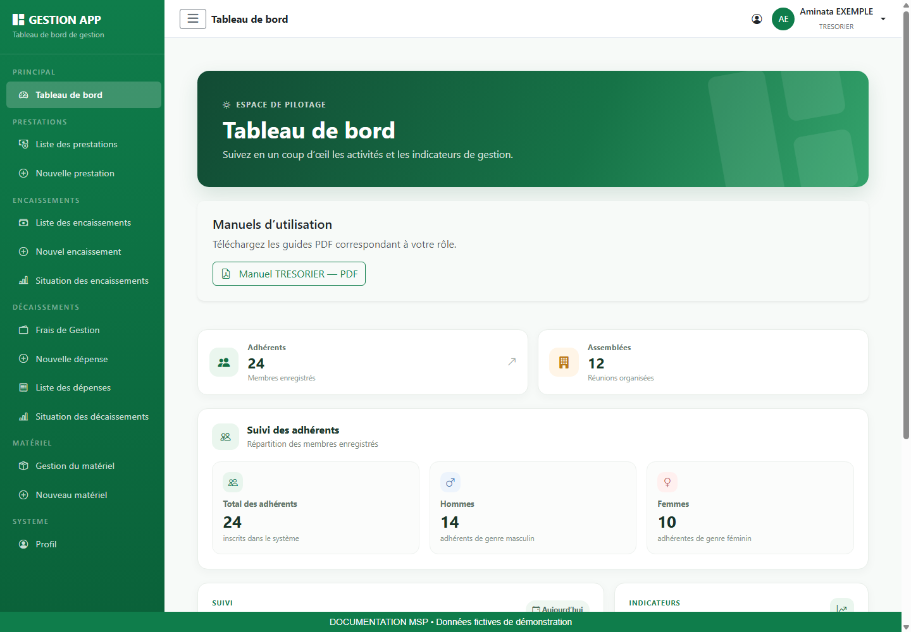

### Lire les illustrations et les commandes

Les images sont de véritables captures de l’interface, réalisées localement avec une API de démonstration et des données fictives. Les écrans de modules sont mutualisés et montrent un compte Administrateur habilité ; les captures du tableau de bord sont propres à chaque rôle. Les listes vides illustrent un écran sans dossier, et non une panne. Les valeurs visibles ne sont pas des données d’exploitation.

| Champ / repère | Comment le renseigner ou le lire |
| --- | --- |
| Vert MSP | Actions principales et repères de navigation ; couleur de référence #0F7D4B. |
| Étoile près d’un champ | Information obligatoire ; compléter également les champs conditionnels affichés. |
| Message rouge | Erreur à lire et corriger avant de recommencer. |
| Bouton désactivé | Action indisponible tant que le formulaire est incomplet, qu’un chargement est en cours ou qu’aucune donnée n’est disponible. |
| Chargement | Attendre le résultat avant de cliquer à nouveau. |

## 2. Se connecter et retrouver son espace

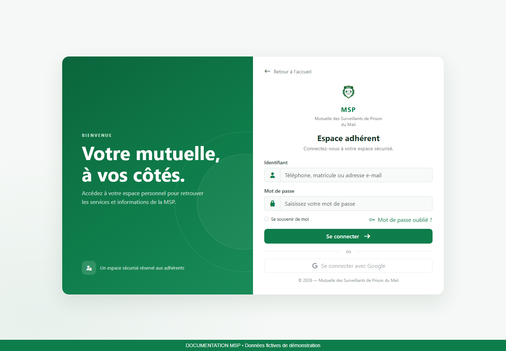

### Connexion pas à pas

1. Ouvrez l’adresse de l’application dans votre navigateur, puis accédez à la page de connexion.
2. Dans Identifiant, saisissez le téléphone, le matricule ou l’adresse e-mail de votre compte, comme indiqué dans le champ. Renseignez ensuite votre mot de passe.
3. Vérifiez la saisie, puis utilisez le bouton de connexion. Attendez la redirection.
4. Sur le tableau de bord, contrôlez le nom et le rôle en haut à droite. Si l’identité ne correspond pas à votre compte, déconnectez-vous.

### Mot de passe oublié ou accès refusé

Utilisez le lien de mot de passe oublié présent sur la page de connexion. Renseignez l’adresse e-mail demandée, puis suivez le lien de réinitialisation reçu. Sur la page de réinitialisation, choisissez et confirmez le nouveau mot de passe. Si le lien n’est plus valable, recommencez la demande ; si vous n’avez pas accès à l’adresse enregistrée, contactez le responsable des comptes.

Si vos identifiants sont refusés, vérifiez la saisie et le verrouillage des majuscules. Si l’échec persiste, faites vérifier l’état du compte. Une erreur de chargement après connexion doit être distinguée d’un mot de passe incorrect.

## 3. Utiliser le tableau de bord et télécharger son manuel

1. Repérez le menu latéral. Le bouton à trois traits permet de réduire ou développer ce menu.
2. Lisez les indicateurs affichés, puis ouvrez un module autorisé si vous devez examiner les dossiers correspondants.
3. Dans Manuels d’utilisation, cliquez sur le bouton du guide associé à votre rôle.
4. Attendez la fin du téléchargement, puis ouvrez le PDF depuis les téléchargements du navigateur.
5. Utilisez le sommaire cliquable ou les signets du lecteur PDF pour retrouver une procédure.

> Si les manuels ne se chargent pas, utilisez Réessayer. Si un téléchargement échoue, vérifiez votre connexion et recommencez après avoir relu le message. Un manuel téléchargé est une copie : téléchargez-le à nouveau après une mise à jour de l’application.

Les statistiques sont des repères de suivi. Le contenu et les raccourcis varient selon les permissions ; un total affiché ne donne pas automatiquement accès à toutes les fiches.

## 4. Enregistrer un encaissement

**Accès :** Menus Encaissements et Nouvel encaissement pour les comptes habilités.

**Objectif :** Tracer une recette avec son type, sa date, son montant et son rattachement budgétaire éventuel.

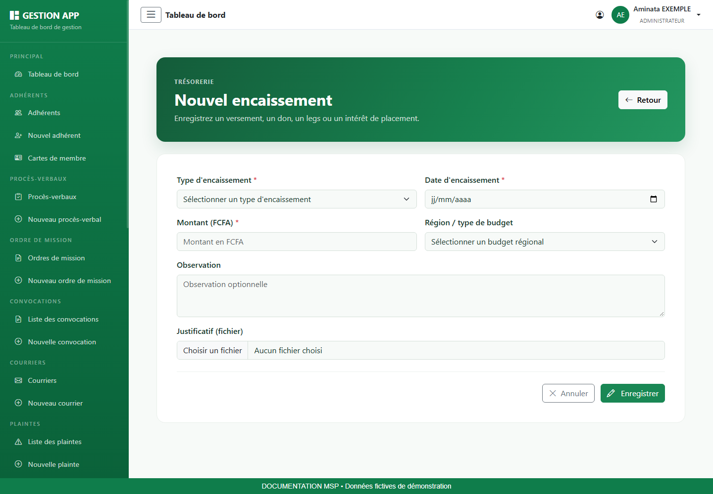

### Champs et informations à vérifier

| Champ / repère | Comment le renseigner ou le lire |
| --- | --- |
| Type d’encaissement | Versement ou Dons, legs, intérêts des placements. |
| Date d’encaissement | Date de la recette. |
| Début / fin de période | Champs affichés pour un versement ; vérifier leur cohérence. |
| Montant (FCFA) | Renseigner le montant à partir de la pièce. Ne pas saisir le symbole monétaire dans le nombre. |
| Région / type de budget | Sélectionner le budget régional concerné lorsque nécessaire. |
| Observation et justificatif | Expliquer la recette et joindre la pièce disponible ; formats proposés : PDF, JPG, JPEG, PNG, DOC, DOCX. |

### Procédure pas à pas

1. Comparez la recette à la liste des encaissements pour prévenir un double enregistrement.
2. Ouvrez Nouvel encaissement et choisissez le type.
3. Renseignez la date et, pour un versement, la période concernée si elle est connue.
4. Saisissez le montant en FCFA et sélectionnez le budget régional s’il est applicable.
5. Ajoutez une observation et le justificatif. Cliquez sur Enregistrer une seule fois puis attendez le résultat.
6. Retrouvez la recette dans la liste. Vérifiez type, date et montant par rapport à la pièce.

### Résultat attendu et contrôles

La recette doit apparaître une seule fois. En modification, vérifiez le nom du fichier existant ; sélectionner une nouvelle pièce remplace la pièce actuelle.

## 5. Lire la situation des encaissements

**Accès :** Menu Situation des encaissements si votre compte peut consulter les encaissements.

**Objectif :** Contrôler les recettes d’un exercice et exporter le rapport affiché.

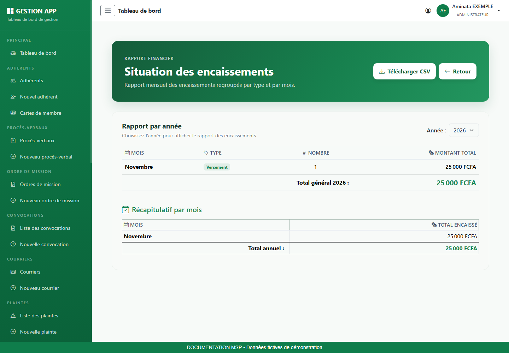

### Champs et informations à vérifier

| Champ / repère | Comment le renseigner ou le lire |
| --- | --- |
| Année | Sélectionner l’exercice voulu ; le rapport est rechargé. |
| Lignes et totaux | Lire les regroupements et montants présentés par le rapport. |
| Télécharger CSV | Télécharger le rapport lorsque des lignes sont disponibles. |

### Procédure pas à pas

1. Ouvrez Situation des encaissements.
2. Choisissez l’année et attendez la fin du chargement.
3. Comparez les regroupements et le total avec les recettes attendues.
4. Si un montant semble incorrect, revenez aux encaissements pour vérifier les enregistrements sources.
5. Utilisez Télécharger CSV si le bouton est actif. Ouvrez le fichier dans un tableur et vérifiez l’année.

### Résultat attendu et contrôles

Un écran sans ligne peut correspondre à un exercice vide. Le bouton de téléchargement reste inactif pendant le chargement ou lorsqu’aucune donnée n’est disponible.

## 6. Préparer les frais de gestion annuels

**Accès :** Menu Frais de gestion, puis l’action de création si elle est disponible.

**Objectif :** Renseigner l’enveloppe annuelle à laquelle seront rattachées les dépenses.

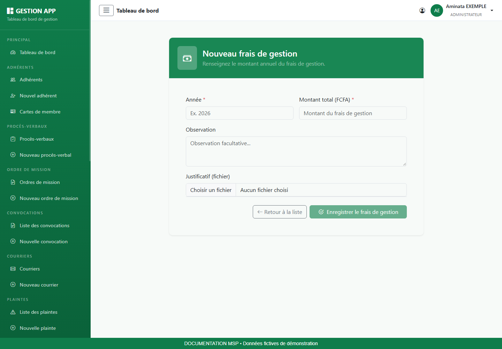

### Champs et informations à vérifier

| Champ / repère | Comment le renseigner ou le lire |
| --- | --- |
| Année | Exercice budgétaire correspondant à l’enveloppe. |
| Montant total (FCFA) | Montant de l’enveloppe de gestion. |
| Observation | Référence ou précision sur l’enveloppe. |
| Justificatif | Pièce disponible permettant d’expliquer le montant. |

### Procédure pas à pas

1. Vérifiez dans la liste si une enveloppe existe déjà pour l’exercice.
2. Ouvrez le formulaire de création. Renseignez l’année et le montant total.
3. Ajoutez les précisions et le justificatif disponibles.
4. Enregistrez puis vérifiez la ligne créée.
5. Lors de l’engagement d’une dépense, sélectionnez l’enveloppe de l’année concernée.

### Résultat attendu et contrôles

L’année choisie doit correspondre à celle de la dépense. Si aucune enveloppe n’est proposée dans le formulaire de dépense, faites vérifier l’existence des frais de gestion et vos droits.

## 7. Engager et corriger une dépense

**Accès :** Menu Dépenses, puis Nouvelle dépense pour les fonctions autorisées à engager une dépense.

**Objectif :** Créer une demande de dépense rattachée à une enveloppe de frais de gestion et la soumettre au circuit de décision.

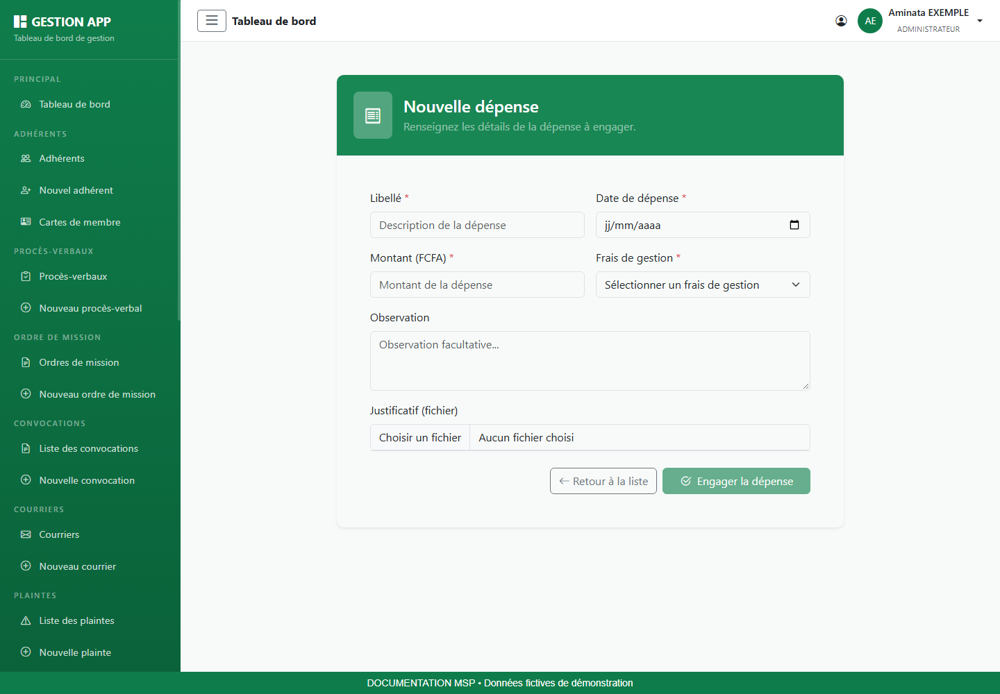

### Champs et informations à vérifier

| Champ / repère | Comment le renseigner ou le lire |
| --- | --- |
| Libellé | Décrire précisément la dépense. |
| Date de dépense | Date correspondant à la demande ou à la pièce. |
| Montant (FCFA) | Montant de la dépense à vérifier sur le justificatif. |
| Frais de gestion | Sélection obligatoire de l’enveloppe annuelle. |
| Observation | Précisions permettant au décideur de comprendre la demande. |
| Justificatif | Facture, devis ou pièce utile ; formats indiqués par le formulaire. |

### Procédure pas à pas

1. Vérifiez l’existence de l’enveloppe et rassemblez la pièce justificative.
2. Ouvrez Nouvelle dépense. Saisissez le libellé et la date.
3. Renseignez le montant et sélectionnez les frais de gestion correspondant à l’exercice.
4. Ajoutez l’observation et la pièce, puis cliquez sur Engager la dépense.
5. Retrouvez la ligne dans Dépenses et vérifiez son statut.
6. Pour corriger une dépense En attente, utilisez Modifier si l’action apparaît ; pour la retirer, utilisez Supprimer puis vérifiez la confirmation.

### Résultat attendu et contrôles

Les commandes de modification, suppression et décision sont proposées pour les dépenses En attente selon les droits. Les statuts de cette version sont En attente, Validée et Rejetée ; aucun statut « Payée » ne doit être déduit de la validation.

## 8. Lire la situation des décaissements

**Accès :** Menu Situation des décaissements selon vos droits de consultation des dépenses.

**Objectif :** Comparer les montants mensuels en distinguant les statuts des dépenses.

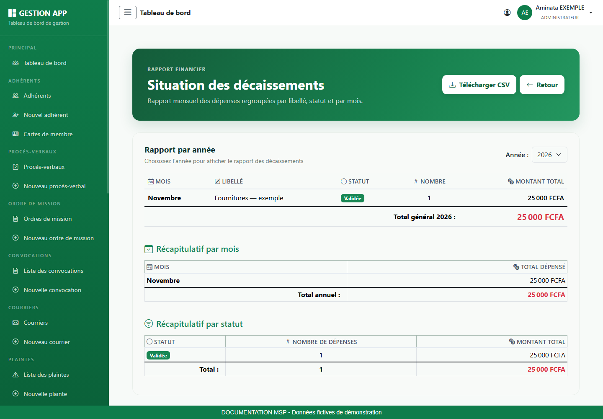

### Champs et informations à vérifier

| Champ / repère | Comment le renseigner ou le lire |
| --- | --- |
| Année | Exercice utilisé pour le rapport. |
| Mois et libellé | Période et description du regroupement. |
| Statut | En attente, Validée ou Rejetée ; lire ce statut avant d’interpréter le montant. |
| Nombre / montant total | Nombre d’enregistrements et somme pour la ligne. |
| Total général | Somme du rapport sélectionné ; elle ne doit pas être interprétée automatiquement comme une somme payée. |

### Procédure pas à pas

1. Ouvrez le rapport et sélectionnez l’année.
2. Repérez les lignes du mois et du libellé recherchés.
3. Lisez séparément les statuts pour éviter de confondre demandes, validations et rejets.
4. Comparez le nombre de dossiers et les montants aux dépenses sources.
5. Téléchargez le CSV si nécessaire et vérifiez le contenu dans votre tableur.

### Résultat attendu et contrôles

Une dépense rejetée peut figurer dans un regroupement portant ce statut. Le rapport présente des enregistrements de dépenses ; vérifiez le périmètre avant toute utilisation comptable.

## 9. Enregistrer une prestation

**Accès :** Menu Prestations ; Nouvelle prestation pour les fonctions autorisées, notamment la trésorerie.

**Objectif :** Documenter la prestation liée à un événement et identifier précisément la personne qui la reçoit.

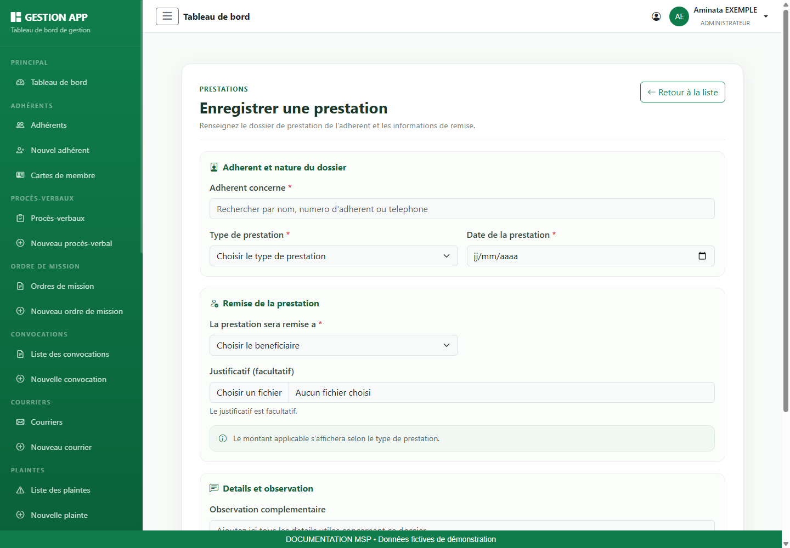

### Champs et informations à vérifier

| Champ / repère | Comment le renseigner ou le lire |
| --- | --- |
| Adhérent concerné | Saisir un critère puis sélectionner le membre dans les résultats. |
| Type de prestation | Retraite, décès d’un proche ou de l’adhérent, prestation décès de l’adhérent, réforme pour invalidité. |
| Date de la prestation | Date associée au dossier. |
| Lien avec l’adhérent | Pour les cas de décès, choisir le lien demandé : adhérent, père, mère, époux, épouse ou enfant. |
| Bénéficiaire | Choisir le destinataire proposé et compléter prénom, nom, téléphone lorsque ces champs apparaissent. |
| Justificatif et observation | Pièce facultative et informations complémentaires utiles à la vérification. |

### Procédure pas à pas

1. Vérifiez que le dossier de l’adhérent est correct et préparez les pièces de l’événement.
2. Ouvrez Nouvelle prestation. Recherchez puis sélectionnez l’adhérent.
3. Choisissez le type de prestation ; renseignez les champs conditionnels qui apparaissent, notamment le lien en cas de décès.
4. Choisissez le bénéficiaire et vérifiez son identité et son téléphone.
5. Renseignez la date et ajoutez les documents disponibles.
6. Enregistrez puis consultez le dossier. Lisez le résultat et le montant présentés par l’application au lieu de supposer un montant libre.

### Résultat attendu et contrôles

Le bénéficiaire peut être différent de l’adhérent concerné. Contrôlez ces deux identités avant de poursuivre le circuit de règlement. Une prestation enregistrée n’est pas une preuve de paiement.

## 10. Rechercher et consulter un adhérent

**Accès :** Menu Adhérents. Cette liste est accessible aux fonctions habilitées ; le simple rôle Adhérent ne fait pas apparaître ce menu dans la version actuelle.

**Objectif :** Retrouver un membre sans créer de doublon et consulter les informations utiles à votre travail.

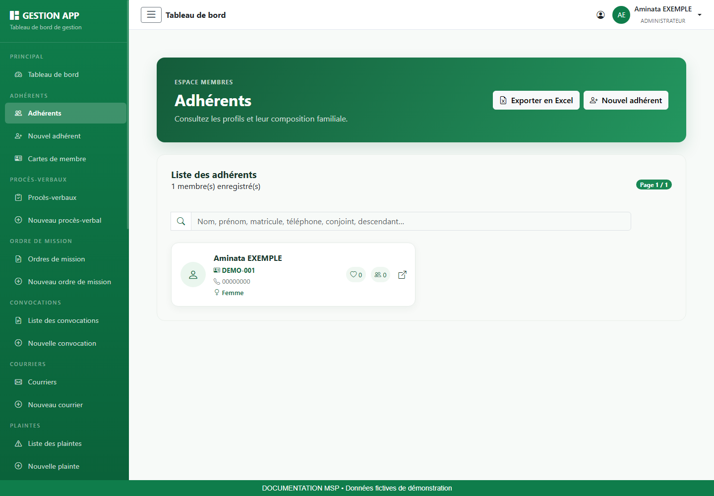

### Champs et informations à vérifier

| Champ / repère | Comment le renseigner ou le lire |
| --- | --- |
| Recherche | Utiliser les critères indiqués dans la zone de recherche, par exemple le nom ou le matricule. |
| Pagination | Changer de page lorsque le résultat ne tient pas sur un seul écran. |
| Actions | Ouvrir la fiche lorsque votre fonction l’autorise ; les commandes de modification et de carte dépendent de vos droits. |

### Procédure pas à pas

1. Ouvrez Adhérents dans le menu latéral.
2. Saisissez un critère précis. Vérifiez l’orthographe et retirez les filtres trop restrictifs si aucun résultat ne s’affiche.
3. Comparez le prénom, le nom et le matricule avant de sélectionner la personne. Deux personnes peuvent porter le même nom.
4. Ouvrez la fiche si l’action est proposée. Consultez les coordonnées, la famille et les pièces jointes nécessaires.
5. Revenez à la liste pour poursuivre votre recherche.

### Résultat attendu et contrôles

Le matricule et l’identité doivent correspondre au dossier demandé. Une liste vide ne signifie pas nécessairement qu’un membre n’existe pas : contrôlez la recherche et la page sélectionnée.

### Export de la liste
Lorsque le bouton d’export est présent, cliquez dessus puis ouvrez le fichier téléchargé dans votre tableur. Vérifiez les colonnes et le nombre de lignes. L’export peut contenir des informations personnelles et familiales ; conservez-le dans l’emplacement de travail prévu. Un message « Aucun adhérent à exporter » indique que l’export ne contient aucune ligne.

## 11. Gérer l’inventaire du matériel

**Accès :** Menu Gestion du matériel, puis Nouveau matériel pour les comptes autorisés.

**Objectif :** Identifier les biens, leur valeur, leur emplacement et leur état.

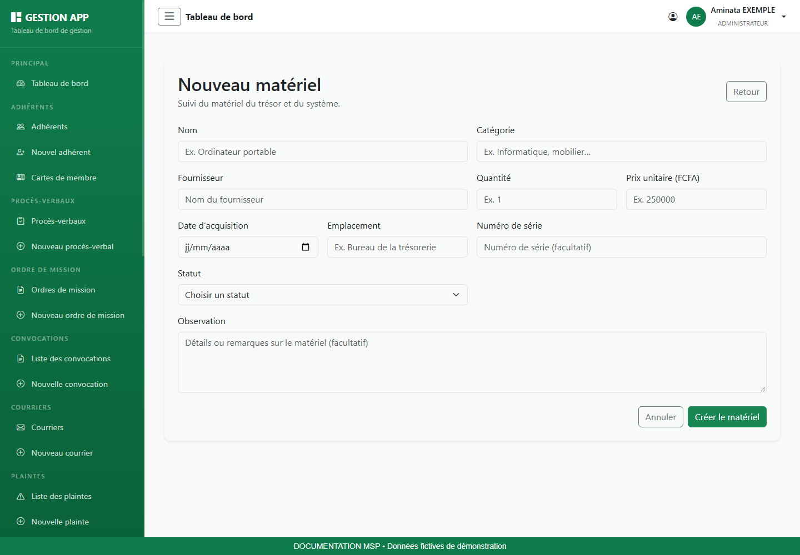

### Champs et informations à vérifier

| Champ / repère | Comment le renseigner ou le lire |
| --- | --- |
| Nom / catégorie | Désignation précise permettant de distinguer le bien. |
| Fournisseur | Provenance du matériel. |
| Quantité / prix unitaire | Nombre d’unités et prix par unité en FCFA. |
| Date d’acquisition | Date figurant sur le justificatif d’achat. |
| Emplacement / numéro de série | Localisation physique et identifiant du bien s’il existe. |
| Statut | Actif, En maintenance ou Hors service. |
| Observation | Précisions sur l’état, le suivi ou l’affectation. |

### Procédure pas à pas

1. Consultez l’inventaire pour éviter un doublon, notamment sur le numéro de série.
2. Ouvrez Nouveau matériel et renseignez la désignation, la catégorie et le fournisseur.
3. Complétez quantité, prix unitaire et date. Ne confondez pas prix unitaire et prix du lot.
4. Renseignez emplacement, numéro de série et statut réel.
5. Enregistrez, retrouvez le bien puis contrôlez sa fiche.
6. Lors d’un changement d’emplacement ou d’état, utilisez la modification si elle est autorisée et précisez l’observation.

### Résultat attendu et contrôles

Le statut doit correspondre à la situation physique du bien. Une mise Hors service n’est pas une suppression : conservez les informations nécessaires à la traçabilité.

## 12. Désigner et suivre un adjoint

**Accès :** Menu Désignation des adjoints uniquement lorsqu’il est proposé et que votre compte est habilité à déléguer.

**Objectif :** Définir une délégation sur une période précise et en suivre l’historique.

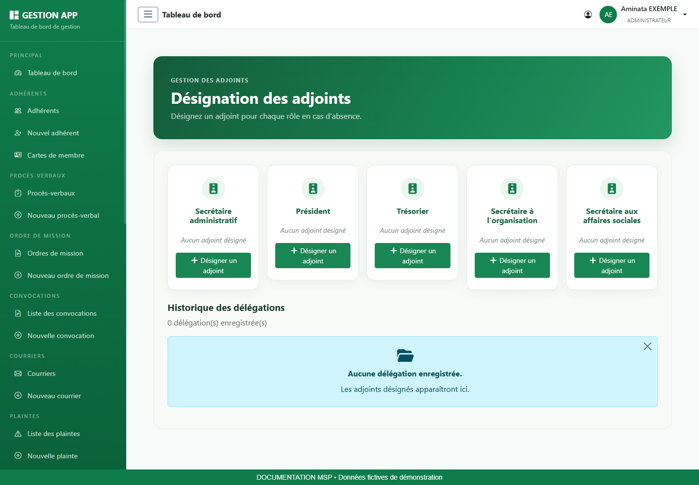

### Champs et informations à vérifier

| Champ / repère | Comment le renseigner ou le lire |
| --- | --- |
| Fonction à déléguer | Choisir la carte de fonction proposée par votre compte. |
| Adhérent adjoint | Rechercher la personne puis la sélectionner dans les résultats. |
| Début / fin | Dates définissant la période de délégation. |
| Motif | Explication utile du remplacement. |
| Historique | Consulter les délégations et les actions de suivi disponibles. |

### Procédure pas à pas

1. Vérifiez la fonction concernée et la période d’absence avant d’ouvrir le formulaire.
2. Dans Désignation des adjoints, cliquez sur la commande de désignation de la fonction autorisée.
3. Recherchez le remplaçant et sélectionnez son identité.
4. Complétez début, fin et motif. Vérifiez que la fin ne précède pas le début.
5. Enregistrez puis contrôlez la présence de la délégation dans l’historique.
6. Si la délégation doit être interrompue ou corrigée, utilisez uniquement l’action proposée sur la ligne et vérifiez son résultat.

### Résultat attendu et contrôles

Le rôle seul ne garantit pas l’apparition du menu : la permission de délégation doit être configurée. La capture présente l’écran d’un compte de démonstration habilité.

## 13. Mettre à jour son profil et son mot de passe

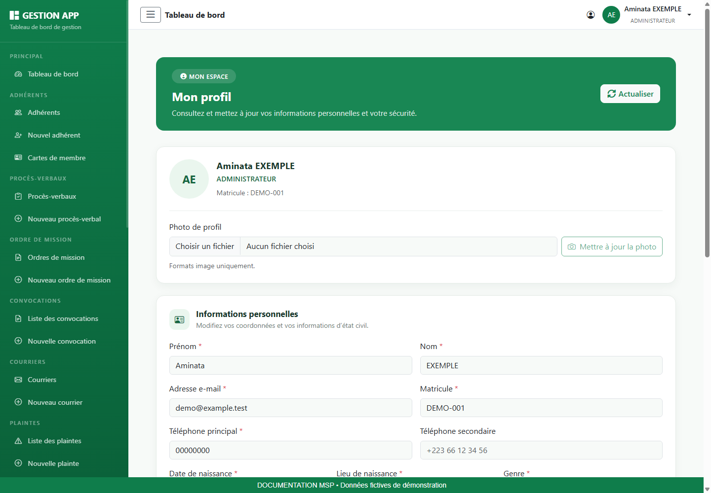

### Consulter et modifier ses informations

1. Ouvrez Profil dans le menu latéral ou utilisez l’accès proposé dans la barre supérieure.
2. Vérifiez l’identité affichée, le rôle et le matricule. Cliquez sur Actualiser si vous devez recharger les informations.
3. Dans Informations personnelles, corrigez les coordonnées ou informations nécessaires. Les champs marqués d’une étoile doivent rester renseignés.
4. Cliquez sur Enregistrer les modifications et attendez la confirmation.
5. Rechargez le profil pour vérifier que les informations enregistrées sont correctes.

### Changer sa photo

Choisissez une image dans la zone Photo de profil, vérifiez l’aperçu, puis cliquez sur Mettre à jour la photo. Cette action possède son propre bouton : sélectionner un fichier ne signifie pas que la photo est déjà enregistrée. Si le fichier est refusé, choisissez un format image accepté et recommencez.

### Changer son mot de passe

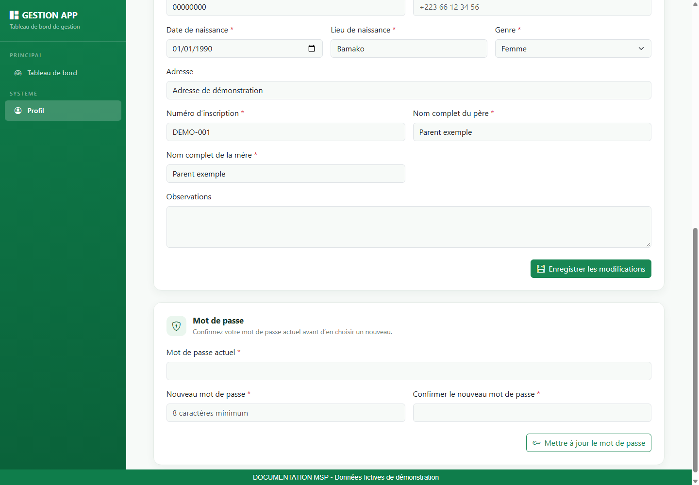

1. Faites défiler le profil jusqu’à Mot de passe.
2. Saisissez le mot de passe actuel.
3. Saisissez le nouveau mot de passe, d’au moins huit caractères, puis la même valeur dans la confirmation.
4. Cliquez sur Mettre à jour le mot de passe et attendez le résultat.
5. Si la saisie est refusée, relisez le message : contrôlez le mot de passe actuel et l’égalité des deux nouvelles valeurs.

> Les informations du profil et le mot de passe s’enregistrent séparément. Le bouton du profil n’enregistre pas automatiquement un changement de mot de passe.

## 14. Terminer sa session et résoudre les difficultés

### Déconnexion

1. Terminez l’enregistrement en cours et vérifiez le message de résultat.
2. Ouvrez le menu de votre compte en haut à droite.
3. Choisissez Déconnexion et vérifiez le retour à l’écran public ou de connexion.
4. Sur un poste partagé, fermez également les documents téléchargés et la fenêtre de navigation.

### Aide au diagnostic

| Champ / repère | Comment le renseigner ou le lire |
| --- | --- |
| Menu absent | Vérifier le rôle affiché et demander le contrôle des permissions. Une illustration du manuel peut montrer un compte plus habilité. |
| Liste vide | Supprimer les filtres, vérifier la période et la pagination. |
| Champs refusés | Relire le message, compléter les champs obligatoires et vérifier les dates, montants et sélections. |
| Bouton Enregistrer grisé | Vérifier les champs obligatoires et attendre la fin du chargement. |
| Fichier non accepté | Vérifier l’extension demandée et la lisibilité. Sélectionner à nouveau la bonne pièce. |
| Erreur réseau ou session expirée | Vérifier la connexion, rouvrir la session puis contrôler si la dernière opération a été enregistrée avant de la répéter. |
| PDF introuvable | Consulter les téléchargements du navigateur ; vérifier le rôle et réessayer le téléchargement sur le tableau de bord. |

### Signaler une difficulté utilement

Transmettez au responsable le module concerné, la référence du dossier, l’action effectuée, l’heure et le message exact. Une capture limitée à la zone en erreur aide à comprendre le problème ; masquez les informations personnelles inutiles. Ne transmettez jamais votre mot de passe.

### Vérification de fin de travail

- Les opérations enregistrées ont été vérifiées dans leur liste ou leur fiche.
- Les pièces sont lisibles et rattachées au bon dossier.
- Les exports ont été conservés dans l’emplacement de travail prévu.
- La session est fermée lorsque le poste est laissé à une autre personne.
